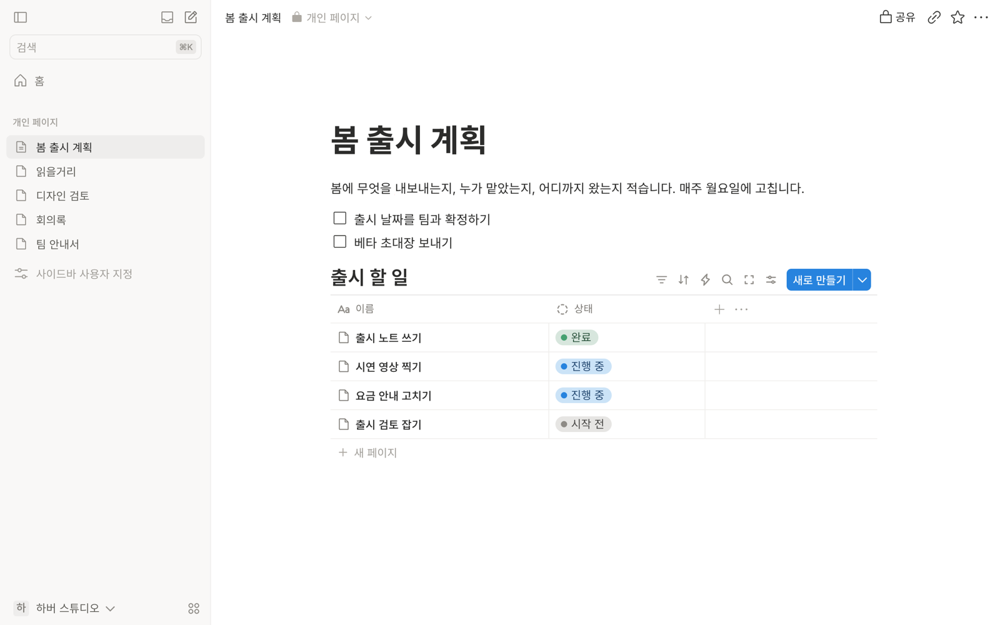

<p align="center">
  
</p>

<h1 align="center">리펜 Leafen</h1>

<p align="center"><a href="README.md">English</a> · 한국어</p>

<p align="center"><b>노션을 오픈소스로 다시 만들었습니다.</b></p>

<p align="center"></p>

## 만든 이유

회사의 일도, 제 삶의 자잘한 기록도 오랫동안 노션에 쌓아 왔습니다. 쌓일수록 그 기록이 곧 제 일이고 제 삶이
되었습니다. 그만큼 소중해진 기록이 남의 서버에 있다 보니, 언젠가 갑자기 사라질까 봐 걱정이 되었습니다.

그래서 노션을 오픈소스로 다시 만들었습니다. 쓰던 방식은 그대로, 데이터는 제가 가진 곳에 두려고요.

- 옮겨 와도 일하는 방식이 바뀌면 안 되니, 노션에서 쓰던 경험과 다르지 않게 만드는 것을 가장 먼저 둡니다.
- 회사에서도 써야 하니, SSO·SCIM·감사 로그·법적 보존·데이터 유출 방지 같은 기업 기능까지 만들었습니다.
- 개인도 써야 하니, 데스크톱 앱 하나로 돌게 했습니다. 서버도 포트 포워딩도 없이 밖에서 폰으로 무료로 열리고,
  중간에서는 누구도 자료를 볼 수 없습니다.
- 집에 둔 오래된 NAS에서도 넉넉히 돌도록 가볍게 만드는 데 신경 썼습니다. 실제 노션 워크스페이스(페이지·행 약 1,800개,
  블록 약 2만 5천 개)를 옮겨 와도 메모리 2GB 한도 안에서 약 500MB로 돕니다.
- 데이터를 제가 갖자고 만든 것이니, 리펜도 남의 데이터를 갖지 않고 어디로도 보내지 않도록 만들었습니다.
- 언제든 통째로 들고 나갈 수 있게, 데이터는 폴더 하나에 두고 백업·내보내기·다른 서버로 옮기기를 갖췄습니다.
- 쓰는 누구나 안심하고 모든 기능을 제약 없이 쓸 수 있어야 한다고 믿기에, 기업 기능까지 모두 AGPL-3.0으로
  열었습니다. 일부 기능만 유료로 묶는 일은 앞으로도 하지 않겠습니다. 리펜은 호스팅도 팔지 않습니다. 서버는
  내 컴퓨터, NAS, 도커, 호스팅 템플릿 등 원하는 곳에 둡니다.

당신의 소중한 기록도 그렇게 지킬 수 있으면 좋겠습니다.

## 목표

노션의 기능을 갖추고, 노션이 할 수 없는 일을 더합니다.

- **노션의 기능.** 페이지와 블록, 데이터베이스와 모든 보기, 관계·롤업·수식, 폼, 버튼과 자동화,
  템플릿, 위키, 댓글과 멘션, 버전 기록, 공개 사이트.
- **옮겨 오고, 가지고 나가기.** 노션 작업공간을 페이지·데이터베이스·관계·파일 구조 그대로 옮겨 옵니다.
  Confluence, Evernote, Obsidian, Logseq, SiYuan, Markdown, CSV도 가져옵니다. Markdown·HTML·PDF로
  내보내고, 서버째 다른 곳으로 옮깁니다.
- **서버가 따로 필요 없습니다.** 데스크톱 앱이 곧 서버입니다. 폰과 다른 기기는 QR로 붙고, 밖에서 쓸
  주소는 내장 Tailscale이 줍니다. 늘 켜 둘 서버가 필요하면 도커 컨테이너 하나로 옮깁니다.
- **잃지 않게.** 연속 복제와 예비 서버 전환, 폴더·WebDAV·S3로 예약 백업, 끊겨도 쓰는 오프라인,
  누가 언제 무엇을 바꿨는지 남는 기록.
- **기업 기능까지 무료.** SSO·SCIM·감사 로그·법적 보존·데이터 유출 방지가 모두 들어 있습니다. 가입은 기본으로
  닫혀 있고, 로그인은 기기 등록(QR·코드)으로 합니다.
- **앱.** 리펜 안에서 도는 앱으로 기능을 더합니다. 문서 보기와 한글 편집, 비밀번호 금고(Bitwarden 호환),
  WebDAV, 웹 클립, 다른 도구 가져오기. 오피스 문서 편집은 앱 목록에서 받습니다.
- **58개 언어.** 화면은 58개 언어이고, 검색은 한국어 붙여 쓴 말과 중국어·일본어·태국어 문장 속 낱말도
  찾습니다.
- **사람이 하는 일은 에이전트도.** 사람이 화면에서 하는 일이라면 무엇이든 쓰시는 에이전트도 API와 MCP로 할 수
  있습니다. Claude, ChatGPT, Codex 같은 에이전트는 그 사람의 권한으로, 화면과 같은 확인을 거쳐 일하고, 바꾼 것에
  이름을 남깁니다.
- **넣지 않는 것.** 노션 AI(AI 글쓰기·검색·에이전트·회의록), 노션 캘린더와 메일, 노션이 운영하는
  마켓플레이스와 템플릿 갤러리는 없습니다. AI는 위처럼 쓰던 것을 연결해 씁니다.

## 지금 어디까지 왔나

지금은 0.1.0 사전 공개판이라 시험용으로 권합니다.

| | |
| --- | --- |
| 다듬기를 마친 것 | 페이지와 블록 편집, 파일·미디어, 사이드바·검색·링크 같은 탐색 |
| 다듬는 중 | 데이터베이스 — 속성, 보기, 필터·정렬, 폼, 템플릿, 자동화, 작업 관리 |
| 다음 차례 | 설치와 계정, 멤버와 팀스페이스, 노션 가져오기, API·MCP 연결과 권한, 공유와 게시, 오프라인, 조직 기능, 앱, 문서 앱, 여러 탭과 끊긴 연결 |

- 데스크톱 앱(macOS·Windows)과 도커로 돕니다. Linux에서는 도커로 띄우고 브라우저로 씁니다. 맥 앱은 Apple의
  서명·공증을 받았고, Windows용은 아직 서명 전이라 처음 열 때 Windows 경고가 뜹니다.
- 다듬는 중인 영역은 노션과 다르게 보이거나 동작하는 곳이 남아 있습니다.
- 서버 한 대(10코어)가 보통 사용자 기준 30만 명 조직을 감당합니다(p95 48ms, 2026-10-22 측정). 잰 방법과
  다시 재는 방법은 [벤치마크](docs/benchmark.md)에 있습니다.

## 앞으로

1. 위 차례대로 영역마다 다듬기를 마칩니다.
2. 전체를 처음부터 다시 점검합니다.
3. **1.0** — 서명된 데스크톱 설치본과 도커 배포판. 이때부터 업데이트 뒤에도 자료가 이어집니다.
4. 그 뒤 — 앱 스토어 배포.

## 설치

1.0 전에는 업데이트 뒤 자료가 이어진다는 보장이 없습니다.

### 에이전트에게 맡기기

쓰시는 에이전트에게 아래 글을 붙여 넣으세요.

```text
https://github.com/leafen-org/leafen/blob/main/docs/install.md 를 읽고 이 컴퓨터에 리펜을 설치한 뒤 설정까지 함께 끝내 줘.
```

에이전트가 리펜을 설치한 뒤 첫 화면들이 묻는 것 — 새로 시작할지 로그인할지, 이름, 언어, 어디서나 열리게 할지,
노션에서 옮겨 올지 — 을 대화로 묻고 한 단계씩 진행한 다음 스스로 연결합니다. 사람은 이름 확인이나 에이전트 허용처럼
리펜이 묻는 곳만 누르면 됩니다. [설치 안내](docs/install.md)는 사람이 직접 따라 해도 되는 같은 문서입니다.
처음 열 때 운영체제가 묻는 확인이나 경고는 에이전트가 우회하지 않고, 무엇을 누르면 되는지 알려 드립니다.

### 데스크톱 앱

[최신 릴리스](../../releases/latest)에서 macOS·Windows용을 받아 띄우고 이름을 넣으면 됩니다.
다른 사람이 늘 쓰게 하려면 늘 켜 두는 컴퓨터에서 돌려 두고 내장 Tailscale 주소로 접속합니다.
Linux용 데스크톱 앱은 없습니다. 도커(아래)로 띄우고 브라우저로 여세요.

### 도커

컨테이너 하나가 서버를 돌립니다([셀프호스팅](docs/self-hosting.md#docker-compose)).

```sh
docker compose up -d
```

새 데이터 폴더에서는 일회용 코드가 든 설정 주소가 로그에 나옵니다(`docker compose logs leafen`). 그 주소를 열고
첫 관리자 이름을 넣으면 됩니다. 리버스 프록시, 백업, 복구, 설정은 [셀프호스팅 안내](docs/self-hosting.md)에
있습니다.

### 소스에서

필요한 것: Go 1.27, Node.js 22.12 이상, macOS에서는 창에 필요한 Xcode 명령행 도구.

```sh
npm --prefix web ci --ignore-scripts
npm --prefix web run build
go build -trimpath -buildvcs=false -o dist/leafen ./desktop
./dist/leafen
```

Windows에서는 명령 프롬프트나 PowerShell에서:

```bat
npm.cmd --prefix web ci --ignore-scripts
npm.cmd --prefix web run build
go build -trimpath -buildvcs=false -o dist\leafen.exe .\desktop
.\dist\leafen.exe
```

`npm.cmd`는 PowerShell의 기본 실행 정책이 npm의 `npm.ps1`을 막기 때문이고, `leafen.exe`는 Go가 이름을 스스로
정할 때만 `.exe`를 붙이기 때문입니다.

Linux에서는 서버만 빌드해 브라우저로 씁니다([도커 없이](docs/self-hosting.md#without-docker)).

## 구조

프로그램 하나(Go)가 화면, API, 파일, 실시간 협업, MCP를 함께 돌리고, 데이터는 폴더 하나에 둡니다.
자세한 것은 [구조 안내](docs/architecture.md)에 있습니다.

## 데이터, 백업, 업그레이드

데이터 폴더가 리펜이 오래 남기는 단위입니다. 통째로 백업하고, 백업은 돌고 있는 폴더 밖에 두고, 중요한
설치를 바꾸기 전에는 새 폴더로 복구를 미리 해 보세요.

```sh
./dist/leafen --dir=/srv/leafen/data backup \
  --output=/srv/leafen-backups/leafen-$(date +%Y%m%d-%H%M%S).zip
```

복구는 기록된 SHA-256 영수증을 확인하고, 이미 내용이 있는 대상은 거절합니다.

```sh
./dist/leafen --dir=/srv/leafen-restored restore \
  --input=/srv/leafen-backups/leafen-20260826-120000.zip \
  --sha256=<64자리-영수증>
```

## 문서

| 안내 | 내용 |
| --- | --- |
| [안내서](docs/guide/README.md) | 기능마다 한 장씩, 사람과 에이전트가 함께 읽는 영어 안내서 — 여기서 시작 |
| [설치](docs/install.md) | 데스크톱·도커·소스 설치, 첫 실행 — 에이전트도 이 문서를 따릅니다 |
| [구조](docs/architecture.md) | 실행 경계, 오래 남는 원본, 권한, 복구 |
| [셀프호스팅](docs/self-hosting.md) | 도커 운영, 설정, 프록시, 백업, 복구, 업그레이드 |
| [개발](docs/development.md) | 빌드, 실행, 생성된 계약, 검사 |
| [MCP 호환](MCP.md) | OAuth·수동 연결, 작업공간 범위, 지원 도구 |
| [리펜 위에 만들기](docs/developers.md) | 키, 등록 앱, API, 웹훅, 보기 링크 |
| [리펜 앱 만들기](docs/apps.md) | 매니페스트, 화면, 워커, 데이터, 서명, `leafen app` 명령 |
| [규제 조직에서 리펜 쓰기](docs/regulated-organizations.ko.md) | 로펌·병원·공공 기관을 위한 안내 |
| [버그 보고](docs/bug-reports.md) | 버그 보고에 넣을 것: 합성 데이터, 재현 순서, 말로 쓴 해결 방안 — 에이전트도 이 문서를 따릅니다 |

## 의견과 기여

버그 보고는 이슈의 버그 양식으로 받습니다. 쓰시는 에이전트에게 맡겨 쓰기를 강력히 권합니다. 아래 글을 붙여 넣으세요.

```text
https://github.com/leafen-org/leafen/blob/main/docs/bug-reports.md 를 읽고 버그 보고를 써 줘.
```

보고에는 [버그 보고 안내](docs/bug-reports.md)대로 재현에 필요한 것만 씁니다. 문제를 보여 주는 지어낸 데이터,
재현 순서, 그리고 생각하는 해결 방안을 말로 적어 주세요. 코드는 받지 않고, 풀 리퀘스트도 지금은
[번역 고침](CONTRIBUTING.md#translations)만 받습니다.
질문과 아이디어는 GitHub Discussions에 남겨 주세요. 모든 글에 답하지는 못하고, 재현되는 것부터 고칩니다. 보안
문제는 공개 글 대신 [SECURITY.md](SECURITY.md)의 비공개 신고로 알려 주세요.

리펜 위에서 도는 앱이나 연동을 만들어 Discussions에서 나누는 것도 환영합니다([리펜 앱 만들기](docs/apps.md)).

## 후원

리펜은 무료입니다. 후원사가 [GitHub Sponsors](https://github.com/sponsors/leafen-org)로 개발비를 댑니다. 모든 후원자와 기여자는
[리펜을 받치는 사람들](docs/sponsors.md)에 이름이 오릅니다. 리펜 안의 후원자 목록(금액 순 100위까지, 회사는 로고)과 홈 맨 아래 회사 상위 열 곳 줄은
첫 출시 뒤 이른 업데이트로 들어오고, 이름은 후원자의 GitHub 프로필로 이어집니다.
원클릭 호스팅 템플릿은 [호스팅 템플릿](docs/hosting-templates.md)에 있습니다.
나라마다 조직의 리펜 도입(설치·지원·운영)을 도울 공식 파트너도 찾고 있습니다. [파트너 안내](https://leafen.org/partners)

<p align="center"></p>

<p align="center"><sub>리펜은 한 사람이 Claude와 함께 만들고 있어요. 주황 머리와 별 핀은 anabology의 열린 캐릭터
<a href="https://claudia.gallery">Claudia</a>에서 빌려 왔어요. 그림은 AI로 만들었습니다.</sub></p>

## 라이선스

리펜을 고치지 않고 쓰기만 하는 것은 집에서든 회사 안에서든 사람 수와 상관없이 무료이고 따로 지킬 것이 없습니다.
AGPL의 의무는 리펜을 고쳐서 다른 사람이 쓰게 하거나(네트워크로 쓰게 하는 것 포함) 리펜을 남에게 나눠 줄 때
생깁니다.

리펜의 서버·웹·데스크톱과 폰 앱·내장 앱은 [AGPL-3.0-only](LICENSE)입니다. 남이 리펜 위에 만들 때 쓰는 것 — 앱
SDK(`sdk/`), 연결 규격(`contracts/`), 예시(`examples/`), 벤치마크 도구(`bench/`), [MCP 안내](MCP.md),
[리펜 위에 만들기](docs/developers.md)와 [리펜 앱 만들기](docs/apps.md) 안내, [번들 파일 형식](docs/bundle.md) — 은
각자 옆에 둔 라이선스 문서대로 Apache-2.0입니다. AGPL과 다른 조건이 필요한 기업은 공식
[파트너](https://leafen.org/partners)를 통한 계약으로 리펜의 상용 사용 허락을 받을 수 있습니다. [NOTICE](NOTICE)에는
리펜이 빼 둔 것과 그 이유가 있습니다.

---

<sub>Notion은 Notion Labs, Inc.의 상표입니다. 리펜은 독립 오픈소스 프로젝트로 Notion Labs와 관계·후원·승인이
없으며, 이 이름은 리펜이 이어받은 작업 방식을 설명하려고만 씁니다. 리펜에는 노션의 코드나 그림이 들어 있지
않습니다.</sub>
