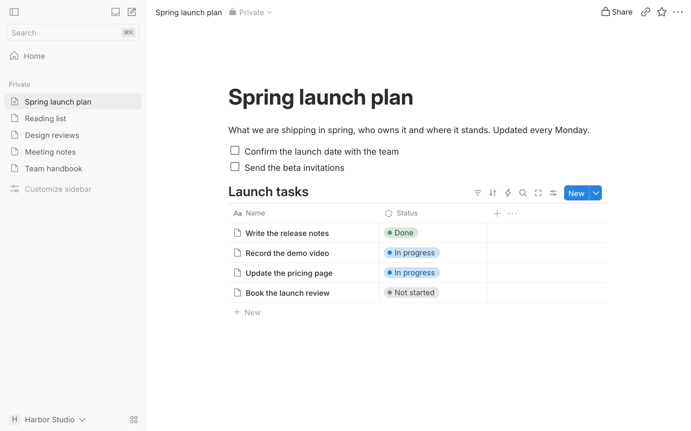

<p align="center">
  
</p>

<h1 align="center">Leafen</h1>

<p align="center"><b>Notion, rebuilt as open source.</b></p>

<p align="center"></p>

Leafen is an early release (0.1). If something breaks or gets in your way, tell the
agent you connected to Leafen: "report this as an issue." It writes the report with
made-up data and shows it to you; once you say yes, it files the issue, or gives you
a link to file it yourself.

## Get started

- **Let your agent do it:** paste this to the agent you use:
  `Read https://github.com/leafen-org/leafen/blob/main/docs/install.md, install Leafen on this computer and take me through its setup.`
- **Desktop app:** download the macOS or Windows build from the
  [latest release](../../releases/latest).
- **Docker:** `docker compose up -d` with the repository's [compose.yaml](compose.yaml).

More in [Install](#install) and the [install guide](docs/install.md).

## Why we made it

For years, both my company's work and the small records of my own life piled
up in Notion. The more they piled up, the more those records became my work
and my life. Records that precious sitting on someone else's server made me
worry they could one day just disappear.

So I rebuilt Notion as open source: the same way of working, with the data
kept where I hold it.

- Moving over must not change how you work, so being no different from the
  Notion you used comes first.
- It has to work for companies, so it has enterprise features too: SSO, SCIM,
  audit logs, legal hold and data loss prevention.
- It has to work for one person, so it runs as a single desktop app. It opens
  from your phone outside the house for free, with no server and no port
  forwarding, and nobody in between can read your data.
- I took care to keep it light enough to run comfortably on an old NAS at home.
  With a real Notion workspace moved in, about 1,800 pages and rows and 25,000
  blocks, it uses about 500 MB of memory within a 2 GB limit.
- It was made so that I hold my data, so Leafen holds nobody else's and sends
  it nowhere.
- So that you can take everything with you at any time, the data lives in one
  folder, with backups, exports and moving to another server built in.
- I believe everyone using it should be able to use every feature with peace
  of mind and no limits, so even the enterprise features are open under
  AGPL-3.0. Putting some features behind a paywall is something I will not
  do, now or later. Leafen doesn't sell hosting either: you run the server
  where you like, on your computer, a NAS, Docker or a hosting template.

I hope it can keep your precious records the same way.

## Goals

Have Notion's features, and add what Notion can't do.

- **Notion's features.** Pages and blocks, databases and every view,
  relations, rollups and formulas, forms, buttons and automations, templates,
  wikis, comments and mentions, version history, public sites.
- **Bring it in, take it out.** A Notion workspace comes over with its pages,
  databases, relations and files as they were. Confluence, Evernote, Obsidian,
  Logseq, SiYuan, Markdown and CSV come in too. Export to Markdown, HTML and
  PDF, and move the whole server elsewhere.
- **No separate server needed.** The desktop app is the server. Phones and
  other devices join by QR code, and the built-in Tailscale gives the address
  to use from outside. When you need a server that is always on, move to a
  single Docker container.
- **Nothing lost.** Continuous replication and failover to a standby server,
  scheduled backups to a folder, WebDAV or S3, offline use when the connection
  drops, and a record of who changed what and when.
- **Enterprise features, free.** SSO, SCIM, audit logs, legal hold and data
  loss prevention are all in. Sign-up is closed by default, and logging in is
  by device registration (QR code or a code).
- **Apps.** Apps that run inside Leafen add features: document viewing and
  Hangul (HWP) editing, a password vault (Bitwarden compatible), WebDAV, web
  clipping, imports from other tools. Office document editing comes from the
  app list.
- **58 languages.** The interface speaks 58 languages, and search finds Korean
  compounds and words inside Chinese, Japanese and Thai sentences.
- **What people do, agents can do.** Anything a person does on screen, the
  agent you use can do through the API and MCP. Agents such as Claude, ChatGPT
  and Codex work with that person's permissions, through the same checks as
  the screen, and leave their name on what they change.
- **What is not included.** Notion AI (AI writing, search, agents, meeting
  notes), Notion Calendar and Mail, and the marketplace and template gallery
  that Notion runs are not here. For AI, connect what you already use, as
  above.

## Where it is now

This is the 0.1.0 pre-release, recommended for trying out.

| | |
| --- | --- |
| Finished polishing | Editing pages and blocks, files and media, getting around (sidebar, search, links) |
| Being polished | Databases — properties, views, filters and sorts, forms, templates, automations, task management |
| Next | Setup and accounts, members and teamspaces, Notion import, API and MCP connections and permissions, sharing and publishing, offline, organization features, apps, document apps, many tabs and dropped connections |

- It runs as a desktop app (macOS, Windows) and in Docker; on Linux, run it in
  Docker and use it in a browser. The Mac app is signed and notarized by
  Apple; the Windows build is not signed yet, so Windows warns the first time
  you open it.
- Areas still being polished have places that look or behave differently from
  Notion.
- One server (10 cores) carries an organization of 300,000 typical users (p95
  48 ms, measured 2026-10-22). How it was measured, and how to measure it
  again, is in the [benchmark](docs/benchmark.md).

## What comes next

1. Finish polishing area by area, in the order above.
2. Check everything again from the start.
3. **1.0** — from then on, your data carries over across updates. Signed
   desktop builds and the Docker image are already out with 0.1.0.
4. After that — app store releases.

## Install

Before 1.0 there is no guarantee that your data carries over after an update.

### Let your agent do it

Paste this to the agent you use.

```text
Read https://github.com/leafen-org/leafen/blob/main/docs/install.md, install Leafen on this computer and take me through its setup.
```

Your agent installs Leafen, then asks you what its first screens ask — start
new or log in, your name, the language, whether it opens from anywhere,
moving from Notion — does each step and connects itself. You press only where
Leafen asks you to, such as confirming your name and allowing the agent in.
The [install guide](docs/install.md) is the same document a person can follow
by hand. Your agent does not bypass the operating system's checks when the
app first opens; it tells you what to click.

### Desktop app

Download the macOS or Windows build from the
[latest release](../../releases/latest), open it and enter your name. For
others to use it all the time, run it on a computer that is always on and
connect through its built-in Tailscale address. Linux has no desktop app: run
Leafen in Docker (below) and open it in a browser.

### Docker

One container runs the server ([self-hosting](docs/self-hosting.md#docker-compose)).
The image is `ghcr.io/leafen-org/leafen`, also on Docker Hub as `leafenorg/leafen`.

```sh
docker compose up -d
```

On a new data folder, the log shows a setup address with a one-time code
(`docker compose logs leafen`). Open it and enter the first administrator's name.
Reverse proxies, backups, restores and settings are in the
[self-hosting guide](docs/self-hosting.md).

### From source

You need Go 1.27, Node.js 22.12 or later, and on macOS the Xcode command line
tools the window needs.

```sh
npm --prefix web ci --ignore-scripts
npm --prefix web run build
go build -trimpath -buildvcs=false -o dist/leafen ./desktop
./dist/leafen
```

On Windows, in Command Prompt or PowerShell:

```bat
npm.cmd --prefix web ci --ignore-scripts
npm.cmd --prefix web run build
go build -trimpath -buildvcs=false -o dist\leafen.exe .\desktop
.\dist\leafen.exe
```

`npm.cmd`, because PowerShell's default execution policy refuses npm's
`npm.ps1`; `leafen.exe`, because Go adds `.exe` only to a name it picks itself.

On Linux, build the server alone and use it in a browser
([without Docker](docs/self-hosting.md#without-docker)).

## Architecture

One program (Go) runs the screens, the API, files, real-time collaboration and
MCP together, and keeps the data in one folder. The details are in the
[architecture guide](docs/architecture.md).

## Data, backups and upgrades

The data folder is the unit Leafen keeps. Back it up whole, keep backups
outside the running folder, and before changing an important installation,
try restoring into a new folder first.

```sh
./dist/leafen --dir=/srv/leafen/data backup \
  --output=/srv/leafen-backups/leafen-$(date +%Y%m%d-%H%M%S).zip
```

A restore checks the recorded SHA-256 receipt and refuses a target that
already has content.

```sh
./dist/leafen --dir=/srv/leafen-restored restore \
  --input=/srv/leafen-backups/leafen-20260826-120000.zip \
  --sha256=<64-character-receipt>
```

## Documentation

| Guide | What it covers |
| --- | --- |
| [The Leafen guide](docs/guide/README.md) | Every feature, one chapter each, for people and agents — start here |
| [Installing Leafen](docs/install.md) | Desktop, Docker and source installs, first run — agents follow this document too |
| [Architecture](docs/architecture.md) | Runtime boundaries, durable sources, permissions, recovery |
| [Self-hosting](docs/self-hosting.md) | Running Docker, settings, proxies, backups, restores, upgrades |
| [Development](docs/development.md) | Building, running, generated contracts, checks |
| [Leafen MCP](MCP.md) | OAuth and manual connection, workspace scope, supported tools |
| [Building on Leafen](docs/developers.md) | Keys, registered apps, the API, webhooks, view links |
| [Building Leafen apps](docs/apps.md) | Manifests, screens, workers, data, signing, the `leafen app` command |
| [Leafen in a regulated organization](docs/regulated-organizations.md) | A guide for law firms, hospitals and public bodies |
| [Reporting a bug](docs/bug-reports.md) | What a bug report holds: synthetic data, steps, the fix in words — agents follow this document too |

## Feedback and contributing

Bug reports go in issues, through the bug form. We strongly encourage writing
them with the agent you use: paste this line to it.

```text
Read https://github.com/leafen-org/leafen/blob/main/docs/bug-reports.md and write a bug report.
```

An agent connected to Leafen already has its bug report tool (`leafen_bug_report`),
so "report this as an issue" is enough, without the line above.

A report holds only what reproduction needs, as the
[bug report guide](docs/bug-reports.md) says: made-up data that shows the
problem, the steps, and the fix you think of in words — we don't take code,
and we don't take pull requests for now, except
[translation fixes](CONTRIBUTING.md#translations). Questions and ideas go to
GitHub Discussions. We can't answer every post; we fix what reproduces first.
Report security problems privately as [SECURITY.md](SECURITY.md) describes,
not in a public post.

Sharing apps or integrations you build on Leafen in Discussions is welcome too
([Building Leafen apps](docs/apps.md)).

## Sponsors

Leafen is free. Sponsors pay for its development through
[GitHub Sponsors](https://github.com/sponsors/leafen-org). Every sponsor and
contributor is named in [the people backing Leafen](docs/sponsors.md). Inside
Leafen, a sponsor list (up to a hundred, largest amount first, company logos)
and a row of the top ten companies at the bottom of Home come in an early
update after the first release; names link to the sponsors' GitHub profiles. One-click hosting templates are
in [hosting templates](docs/hosting-templates.md).
We're also looking for official partners who help organizations in each
country adopt Leafen, from installation to support and operations.
[Partners](https://leafen.org/partners)

<p align="center"></p>

<p align="center"><sub>Leafen is built by one person with Claude. The orange streak and star clip are borrowed from
<a href="https://claudia.gallery">Claudia</a>, an open character by anabology. AI-generated image.</sub></p>

## License

Using Leafen as it is, at home or inside a company and for any number of
people, is free and asks nothing of you. The AGPL's duties start only when you
change Leafen and let others use it (over a network too), or pass Leafen on to
others.

Leafen — its server, web client, desktop and phone apps and built-in apps — is
[AGPL-3.0-only](LICENSE). What others use to build on Leafen is Apache-2.0,
each with that license's text beside it: the app SDK (`sdk/`), the connection
contracts (`contracts/`), the examples (`examples/`), the benchmark tools
(`bench/`), the [MCP reference](MCP.md), the guides to
[building on Leafen](docs/developers.md) and [Leafen apps](docs/apps.md), and
the [bundle file format](docs/bundle.md). A company that wants other terms than
the AGPL can get Leafen's commercial license in a contract through an official
[partner](https://leafen.org/partners). [NOTICE](NOTICE) lists what Leafen
leaves out and why.

---

<sub>Notion is a trademark of Notion Labs, Inc. Leafen is an independent open
source project with no affiliation with, sponsorship by or endorsement from
Notion Labs; the name is used only to describe the way of working Leafen
carries on. Leafen contains none of Notion's code or artwork.</sub>
