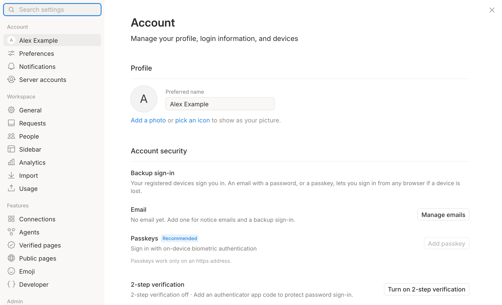

# Accounts and devices

<!-- guide-sources:
web/src/components/auth/SignInWays.tsx
web/src/components/auth/AuthGateScreen.tsx
web/src/components/account/AccountAddDevice.tsx
web/src/lib/useDeviceCode.ts
web/src/locales/en/authGate.json
web/src/locales/en/workspaceSettingsDialog.json
internal/app/auth_wire.generated.go
internal/app/account_device_codes.go
internal/app/mcp_tool_sign_in_requests.go
internal/app/administrator.go
-->

This chapter covers your Leafen account: how you log in, how a phone or
another computer joins it, the backup ways in, two-step verification, and the
list of your devices. It is for everyone with an account. Members,
invitations and roles in a workspace are in
[Workspaces and members](workspaces-and-members.md); an administrator's tools for people who lost every device are in
[Self-hosting: Lost devices and forgotten passwords](../self-hosting.md#lost-devices-and-forgotten-passwords).

## How an account works

A Leafen account belongs to one server. It needs only a name: the person who
sets up a server and people who accept an invitation choose a name, and they
are in. An email and a password are optional.

Your devices are how you log in. A browser or app that logged in stays
logged in until it is logged out. A device that is already logged in lets
another join with a one-time code, with no password. An email with a
password, or a passkey, is a backup way in from any browser, for when a device
is lost.

## Log in on a new device

The login screen offers its ways in this order:

1. **Log in with a code**, with a line under it that says where the code
   comes from: on a device that is already logged in, choose the workspace name
   in the sidebar → **Add a device**.
2. **Log in with AI**, right under that line, for when an agent such as
   Claude or Codex is connected to Leafen as you.
3. **Log in with email**, **Log in with a passkey**, a **Continue with …**
   button for each login provider the server's administrator set up (such as
   Google), and **Log in with your company account** when an organization on
   the server logs its people in with its own identity provider.

**Create account** is at the bottom. A server set up now lets in only invited
people, people from a workspace's allowed email domains and people logging in
with their organization's SSO; anyone else is told that sign-up is closed and
whom to ask.

In the desktop app and the iPhone app, the login page of the app's own
server first offers **Log in as this device's owner** (Touch ID, Face ID,
Windows Hello or the device's password), as the
[Desktop and phone apps](desktop-and-phone-apps.md) chapter shows.

### With a code from another device

1. On a device that is logged in, open the workspace name in the sidebar →
   **Add a device** (or Settings → your name → **Devices** → **Add a
   device**). It shows a QR code and a code of 12 digits, such as
   `1234-5678-9012`.
2. On the new device, choose **Log in with a code** and type the code, then
   **Continue**. Where the device has a camera, **Scan a QR code** on the same
   screen reads the QR code instead: the Leafen phone app's scanner, or a browser's camera on an
   https address. A phone's own camera app can open the QR code too.
3. The new device is logged in, and the first device says **The new device is
   logged in**.

A code works once, for 10 minutes. A device that joins stays logged in until
it is logged out, or until an organization's session length ends it. While
**Add a device** stays open, a new
code appears before the old one runs out; **Done** ends the code. While the
server has no outside address, **Add a device** says that only this computer
can open its address, with a link to **Turn on outside access** (see
[Outside address](outside-address.md)). If your organization allows only
single sign-on, **Add a device** says so, and the new device logs in with the
company account.

With no logged-in device left, choose **No device logged in?** on the code
screen. A member asks an administrator for a one-time code; the
administrator makes one with **Device code** on the person's row in Settings →
Server → **Users**. Someone who runs the server makes one on the server's
computer with `leafen account device-code`, as
[Self-hosting](../self-hosting.md#lost-devices-and-forgotten-passwords) shows.
While no administrator has the server open on a device, the login screen
opened on the server's own network (the same computer, a private network,
Tailscale) adds one line under **Log in with a code**: "If you’re an
administrator with no device logged in, get a one-time code from the
server’s computer." **Show how** under it says where the server log is and
that `leafen setup status` shows the code too. Opened from outside, the
screen doesn't show that line.

### With an agent

If an agent such as Claude Code or Codex is connected to Leafen as you, it can
log a browser in:

1. On the login screen, choose **Log in with AI**, under **Log in with a
   code**. The screen shows the sentence to send, such as "Approve the Leafen
   login: QXR·KX7-4QP", with **Copy** beside it, and under it "Use it once,
   within 5 minutes."
2. Press **Copy** and send the sentence to your agent. The agent asks you once
   more, naming the browser, its address and when it asked; say yes in the
   conversation.
3. The browser logs in within a few seconds.

When the agent works in the browser itself (its own, or yours through an
extension such as Claude in Chrome) and finds Leafen logged out there, it asks
you once; with your yes it opens **Log in with AI** there itself and
approves the code that screen shows.

The code begins with this server's own three letters (as in `QXR·KX7-4QP`), so
an agent connected to more than one Leafen knows which one to approve it on.
It works once, for 5 minutes. The approval goes to your inbox, and the
device appears in your devices list. The agent never sees a password or a
code of its own: it only approves the code on a login screen, one it opened
with your yes or one you sent it. Turn this off with **Login approval by
agents** in Settings → your name → **Devices**.

### With email and password

**Log in with email** takes the account's email and password. **Forgot your
password?** mails a reset link when the server sends mail; the link works once,
for 1 hour, and a new password logs every device out. A server that sends no
mail says so and asks you to turn to an administrator, who gives you a
temporary password; you choose your own at the next login.

Five wrong passwords for one account within 15 minutes make its next
password login wait 1 minute; each wrong password after a wait doubles it
(2, 4, 8 minutes), up to 15 minutes. The screen says how long. The account is
never locked: a code from a logged-in device, a passkey and SSO never wait.

## Your account settings

Open the workspace name in the sidebar → **Settings**, then your name under
**Account**.

### Backup login

Under **Account security** → **Backup login**:

- **Email**: **Manage emails** adds addresses you log in with; one is
  **Primary** and gets account notices. Adding one sends a code to it, unless
  the server sends no mail. Up to 5 more addresses besides the primary one.
- **Passkeys**: **Add passkey** logs you in with the device's fingerprint,
  face or screen lock. Up to 5 passkeys. Passkeys work only when the server
  has an https address.
- **Password**: **Add password** sets one for logging in with your email. A
  password is at least 15 letters long, or at least 8 characters with both
  letters and numbers. Changing it logs your other devices out.
- **2-step verification**: **Turn on 2-step verification** adds a 6-digit code
  from an authenticator app after password login, with 8 recovery codes to
  keep. A device that joins with a code carries the second step of the device
  that made the code.

**Local data lock** locks the copy of your pages kept on this device for
offline use with a passphrase. A forgotten passphrase loses the offline edits
that have not synced yet.

### Devices

**Devices** lists every device logged in to your account, with its name, when
it was last active and where. **Log out** on a row ends that device at once;
**Log out of all devices** ends every one but this. An account can be signed
in on 25 devices at most: logging in on another asks to log out the one used
least recently.

**Login history** lists each attempt to log in, newest first, and how it
logged in.

### More accounts on one device

The workspace menu's **Add account** signs another account of the same server
in on this device, and each stays logged in. Settings → **Server accounts**
lists the accounts on other Leafen servers logged in on this device; you work
on one server at a time.

### Deleting your account

**Delete my account** under **Support** deletes your account and the
workspaces only you own, for good. It is refused while you are a server's last
administrator.

## Names, limits and defaults

| Name | Limit or default | Notes |
| --- | --- | --- |
| Device code (Add a device) | 12 digits, once, 10 minutes | Renewed while the window is open. |
| Agent login code | Once, 5 minutes | Approved by an agent connected as you, after you say yes. |
| Devices logged in | 25 per account | The least recently used one is offered to log out. |
| Passkeys | 5 per account | https address only. |
| Secondary emails | 5 | Besides the primary email. |
| Password | At least 15 letters, or at least 8 characters with letters and numbers | |
| Wrong passwords | 5 in 15 minutes, then a wait of 1, 2, 4, 8 and at most 15 minutes | Never a lock; other ways in don't wait. |
| Password reset link | Once, 1 hour | Only on a server that sends mail. |
| 2-step verification | 6-digit codes every 30 seconds, 8 recovery codes | For password login. |
| Sign-up | Invited people only | On a server set up now; the administrator changes it in Settings → Server → **Sign-up and login**. |

## For agents and the API

An agent connected to Leafen as you uses `leafen_sign_in_requests` to approve
the code a browser shows under **Log in with AI**, only after you say
yes in the conversation. It takes only the code on a Leafen screen it opened
with your yes; any other code only from you. It cannot make a device code, a
password or a passkey for you. The `leafen account device-code` and
`leafen account reset-password` commands run on the server's computer; see
[Self-hosting](../self-hosting.md#lost-devices-and-forgotten-passwords).

## Differences from Notion

- Notion logs you in with an email and a code or password each time. Leafen
  logs new devices in with a one-time code from a device you already have,
  and an email is optional.
- An invitation lets someone in with only a name.
- The account switcher shows each account as the server and the name, with the
  email when you point at it.

## Related chapters

- [Agents](agents.md)
- [Desktop and phone apps](desktop-and-phone-apps.md)
- [Outside address](outside-address.md)
- [Organizations and audit](organization-and-audit.md)
- [Self-hosting: Lost devices and forgotten passwords](../self-hosting.md#lost-devices-and-forgotten-passwords)
