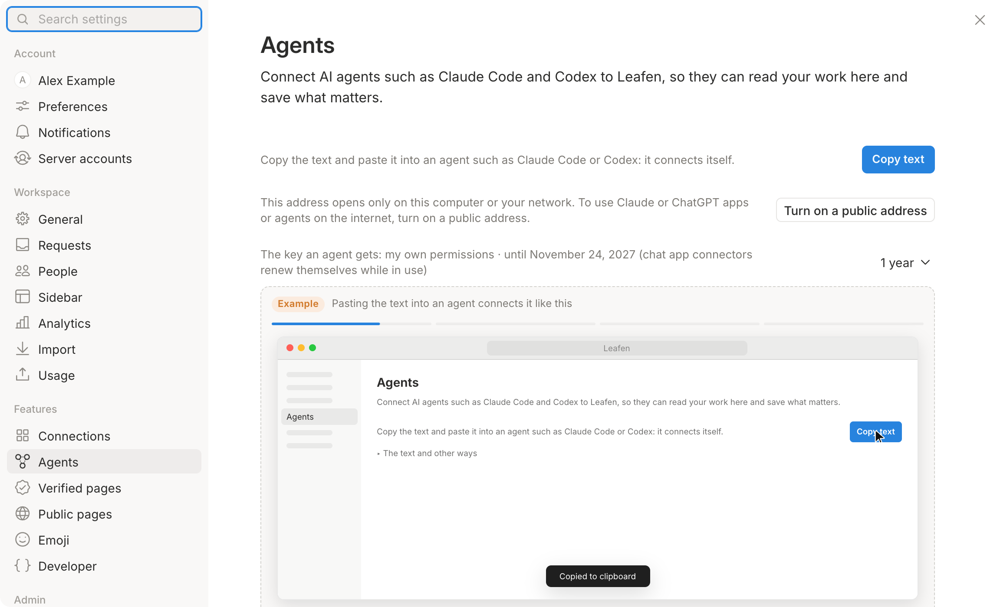

# Agents

<!-- guide-sources:
web/src/components/settings/AgentConnect.tsx
web/src/components/settings/KeyLifetimeRow.tsx
web/src/lib/claudeConnector.ts
web/src/lib/personalAccessTokens.ts
web/src/locales/en/workspaceSettingsDialog.json
web/src/locales/en/authGate.json
internal/app/mcp_oauth_wire.generated.go
internal/app/mcp_connection_codes.go
internal/app/mcp_device_connections.go
-->

This chapter shows how to connect an AI agent you already use, such as Claude
Code, Codex, Cursor or the Claude and ChatGPT apps, to Leafen over MCP, and
how it works there: as you, with your access, within a key's limits. It is for
anyone who uses an agent. Every MCP tool, with its name and what it does, is
in the [MCP reference](../../MCP.md); the API is in
[Building on Leafen](../developers.md).

Leafen has no AI or agent of its own. An agent comes in from outside and
sends what it works on to its own model.

## Connect an agent

Open the workspace name in the sidebar → **Connect an AI agent**, or Settings →
**Agents** (under **Features**). The first run of a new server offers the same
step, **Connect your AI agents**.

### Claude Code, Codex and other agents that run commands

1. Press **Copy text**.
2. Paste it into the agent. The text holds a one-time code that works once,
   within 10 minutes; **New code** under **The text and other ways** makes
   another. If the agent's command traded the code but couldn't save the key,
   it runs the same command again within those minutes: the code trades once
   more while that key is unused, and the first key stops working, so no
   connection is left that no agent holds.
3. The agent connects itself with the code and appears under **Connected
   agents**: no login and no browser. It runs one command, which you allow
   when it asks — Claude Code's in a terminal and in the Claude app alike,
   and Codex's — that trades the code for a key and puts the key straight
   into the agent's own settings, for every folder, so the key never shows in
   the conversation. Each command comes for a shell such as bash (macOS,
   Linux, Git Bash on Windows) and for Windows PowerShell, and the agent runs
   the one for its shell as it is. Another agent that runs commands does the
   same its own way.
4. Go on in the same conversation. Claude Code in a terminal shows Leafen's
   tools once you type `/reload-plugins`, which the agent asks you to do,
   and then send “continue” — Claude Code doesn't go on by itself after
   `/reload-plugins`;
   elsewhere, as in the Claude app, the agent calls Leafen over the web itself
   until its tools show from your next conversation. It then asks how to
   start — moving your Notion here, with the link to the screen where your
   Notion key goes, or an empty workspace.

The line under **Copy text** says what the agent gets: **my own
permissions**, until a date. Choose how long the key lasts beside it: 7, 30,
90 or 180 days, or 1 year (the default). A chat app's connector renews its
key itself while in use.

### An agent on the computer Leafen runs on

**An agent on the computer Leafen runs on** gives a text that tells the agent
to connect with Leafen's own program, with no browser. The program is
`/Applications/Leafen.app/Contents/MacOS/leafen-desktop` for the Mac app,
`.\leafen-desktop` in its folder for the Windows app,
`docker compose exec leafen leafen` for Docker, and `dist/leafen` with
`--dir=<its data folder>` from source, as
[Installing Leafen: The first run by commands](../install.md#the-first-run-by-commands)
shows; `leafen` below stands for it.

1. The agent runs `leafen connect --name "<the agent's name>"`, with nothing
   added. This connects nothing yet and changes none of its settings: it
   answers with the question to ask you, naming the agent, the account, the
   workspaces and what it may do.
2. The agent asks you that question in the conversation and waits for your
   own answer.
3. Only on your yes, it runs the same command again with `--approved`. For
   Claude Code (`--approved --add-to claude-code`), Leafen adds itself to Claude Code's
   settings for every folder, and the key never shows to the agent; with
   Leafen in Docker, one line hands the key from the container to Claude Code
   the same way. Another agent gets the MCP address and the key, once, with
   the line that adds them. The agent appears under **Connected agents**, and
   tells you that Leafen is in every folder: if you want it in one folder
   only, say so.
4. Go on in the same conversation. Claude Code in a terminal loads Leafen's
   tools into it once you type `/reload-plugins`, which the agent asks you
   to do, and then send “continue”: Claude Code doesn't go on by itself after
   `/reload-plugins`. Claude Code without a terminal, as in the Claude app, shows them
   from your next conversation; until then the agent carries on in this one
   through `leafen mcp call`, which calls Leafen's tools with the key
   Claude Code holds (with Leafen in Docker, by calling Leafen's MCP over the
   web itself).

`--this-folder` keeps Claude Code's connection to one folder, and `--email`
or `--account` connects it as another account than the server's first
administrator. The agent asks only the one question; these are for when you
ask for them.

### One folder, or another program — by the agent

Ask an agent already connected to Leafen to connect a folder — "connect this
folder too" — and it does it itself, on any computer, with nothing for you to
press: with its own connection it makes a one-time code
(`POST /api/leafen/v1/mcp/connection-codes` with `clientName`), and the
code's answer gives it one command that, run in that folder, hands the new
connection's key from Leafen straight into Claude Code's settings for that
folder alone, shown nowhere. Like every agent connection it works as you in
all your workspaces; the folder's own rules (its `CLAUDE.md`) say which
workspace it works in. On Leafen's own computer `leafen connect
--this-folder` does the same. Claude Code's own login (`/mcp` and its button)
is only for when you are on that screen yourself.

### The name Leafen takes in the agent's settings

Leafen goes into the agent's settings named after the server and its
three-letter code, `leafen-<server>-<code>` (`leafen-maple-kdr`), the same
in every folder and on every computer, so rules and allow lists that name
its tools (`mcp__leafen-maple-kdr__…`) hold everywhere, and two servers of
the same name differ. A connection the settings already hold to this server
that works as you is kept, and nothing new is made. Another person's
connection in the same settings — two people on one computer account — is
never used for you: Leafen goes in beside it as
`leafen-<server>-<code>-<your first name in plain letters>`
(`leafen-maple-kdr-ann`). Each name stays short enough for Claude's
64-character tool names, and Leafen never renames or removes an entry there.
Under **Connected agents**, each connection is listed by its program and the
computer it was made on, and the folder when it is kept to one.

### The Claude and ChatGPT apps, and other MCP clients

These connect to Leafen's MCP address, the server's address followed by
`/api/leafen/mcp`, which **MCP address and keys** in Settings → **Agents**
shows.

1. Add a custom connector with that address: in Claude, Customize →
   Connectors → Add → Add custom connector; in ChatGPT, Plugins → + → Add
   custom MCP server. **Connect Cursor** and **Add to VS Code** do the same for
   those editors.
2. The client opens Leafen's login in the browser, then **Approve MCP
   connection**: it says the agent works as you in all your workspaces;
   press **Allow connection**, or **Deny**.

The apps on the internet need an https address: until the server has one,
**Agents** says the address opens only on this computer or your network, with
**Turn on a public address** (see [Outside address](outside-address.md)).

Claude's custom connector connects only to an https address without a port
(443): at an address such as `https://wiki.example.com:8443`, Claude's check
answers that the server didn't respond. Only the connector stops there —
browsers, Leafen's apps and agents such as Claude Code work at that address as
it is — so when the server's address carries another port, **Agents** says so
beside the connector's address, and the connection text says so to the agent.
For a connector, use Leafen's Tailscale, your own Cloudflare tunnel, or an
address opened on port 443.

### An agent on another computer

An agent on another computer that asks to connect shows you a code. Type it
under **An agent on another computer** and press **Continue** to see which
agent asked and from where, then **Allow** or **Decline**. Or tell an agent
that is already connected: "Allow the Leafen connection" followed by the code.
A code waits 10 minutes.

## How an agent works in Leafen

There are two kinds of connection:

| | Agent connection | MCP token |
| --- | --- | --- |
| What it is | Your shadow: it works as you | As Notion's MCP token, it works as you |
| What it may do | Everything you can — read, edit and, if you are an administrator, manage | What you can, with the tools you leave on on its page |
| Where | All your workspaces, those you join later too | One workspace, and the pages you choose on its page |
| Made by | Connecting an agent (the text, `leafen connect`, a code from another computer, a chat app's connector) | **Create key** on Agents, or **MCP tokens** in the developer tools |
| History | Your name | Your name |

A Notion-compatible internal integration token (the `/v1` API) is different:
it is a bot of its own, reaching only the pages shared with it, with its own
name in page history, and Leafen's MCP doesn't take it.

Ask your agent for a connection — "just for this folder", say — and it
suggests the one that fits: an agent connection for an agent that works for
you; an MCP token for a narrowed key you hand to another program; an internal
integration for an external service that uses the Notion-compatible API.

A folder that several computers open — a NAS's shared folder, a synced one —
keeps in its own settings only Leafen's address and, if it needs a key, a
narrowed MCP token for one workspace and the tools it uses. Your agent
connection's key belongs to one computer and stays in that computer's own
settings; each computer does the wider work through its own agent
connection. A folder copied or passed on whole takes the keys inside it
along.

- **As you.** Either kind does what you can, with your access. What it
  changes is recorded as yours in page history and the audit log. Where it
  reaches several workspaces and a request doesn't say which (a new page with
  no parent, say), the agent picks one from what it works on or knows, and
  asks you only when it can't tell.
- **Within your organization's policy.** An organization's **Organization key
  policy** on **Agents** can stop members from making keys, hold what keys may
  do lower, and require keys to expire.
- **Only into pages that let agents in.** A page's share window decides who
  may let agents into it; by default, only people with full access to the page.
- **Doing the steps itself.** An agent does every step it can. Where only you
  can act (a real secret, a press only you may make), it opens that screen,
  fills the rest and shows you just that step, marked on a picture, instead
  of handing the work back to you.
- **Asking you first.** Some steps always come back to you in the
  conversation: logging in a browser, moving a server, a backup code, and a
  yes before it makes something for you on another service, such as the
  Notion connection a move reads through. When Leafen is logged out in a
  browser the agent works in, it asks you once, then presses **Log in with
  AI** there itself and approves the code that screen shows. An agent never sees a password, a recovery code or another person's
  login.
- **With your inbox, when you ask.** An agent reads the notices in your Leafen
  inbox, such as comments, mentions and approvals for you, when you ask about
  them or the work at hand concerns one, and tells you only what bears on
  that. It doesn't bring them up on its own: you see them in Leafen.

## Lines for your instruction file

**Lines for your instruction file**, under **The text and other ways**, gives
a few lines to add to your agent's user-wide instruction file
(`~/.claude/CLAUDE.md` for Claude Code, `~/.codex/AGENTS.md` for Codex), so the
agent uses Leafen as your shared memory in every project. They also ask the
agent to update their address when Leafen says it changed, so after a move
of your server the agent fixes them itself; Leafen only says where it is
now. To keep it to one folder, move them to that folder's own `CLAUDE.md` or
`AGENTS.md`. Press **Copy** and paste them there.

## See and disconnect agents

**Connected agents**, in Settings → **Agents**, lists each agent with its
workspaces, when its key ends and when it was last used. Open its menu
to disconnect it; it can't read or change the workspace until it connects
again. When you connect an agent again and Leafen goes in beside an earlier
connection, the agent asks you once whether to remove the earlier one if it
no longer works or you won't use it; on your yes it disconnects it here and
takes it out of its own settings. A workspace's administrators
see **All agent keys**, every key and OAuth connection that reaches the
workspace, without their values, and can end any of them at once.

If the server's outside address changes, agents that connected through the
old one show **Reconnect**; paste a new text into them.

## Names, limits and defaults

| Name | Limit or default | Notes |
| --- | --- | --- |
| Agent connections | 32 per person | Across all workspaces. |
| Key lifetime | 1 year | Or 7, 30, 90 or 180 days; a chat app's connector renews itself. |
| Connection code in the text | Once, within 10 minutes | **New code** makes another. |
| Code from an agent on another computer | 10 minutes | |
| What a connection may do | Everything you may | An MCP token, the tools left on on its page. |
| MCP address | The server's address + `/api/leafen/mcp` | https, except on this computer. |
| Who lets agents into a page | People with full access | Set in the page's share window. |

## For agents and the API

An agent reading this: the tools are listed in the
[MCP reference](../../MCP.md). The common work — pages, rows, search, the
trash — goes with the tools on your list; `leafen_operations` holds the rest,
every native API operation among it, in groups named for what a person sets
out to do (call it without arguments, then name one as `group`; English words
as `query` find them too), and `leafen_call` runs one;
`leafen_inbox` reads the person's unread notices when they ask about them or
the task concerns one; `leafen_connection_requests`
allows or declines another agent's connection with the code the person gives
you; `leafen_sign_in_requests` approves a browser's login code. Do all you
can yourself, up to what only the person can do (a real secret, a press only
they may make); then show them just that step, marked on a picture. Before
you say you can't or hand a step over, look through `leafen_operations`'
groups: a group lists what your connection can run and counts in one line
what it can't (`all: true` lists those too, each with what it lacks), and
within the task you do what it can. If
Leafen is logged out in a browser you work in, ask them once, then press
**Log in with AI**, under **Log in with a code**, there yourself and approve
the code it shows. Take only the code on a Leafen screen you opened with their
yes; any other code only from the person. Ask them in their words.

## Differences from Notion

- The editor and the app have no built-in AI. Your own agents connect over
  MCP and work as you.
- Agents can do through the API and MCP everything a person saves on screen.
- An organization decides which MCP clients may connect, instead of Notion
  AI's settings.
- A custom MCP connection serves every agent connected to Leafen, and Leafen
  holds its login.
- By default only people with full access to a page let agents into it.

## Related chapters

- [Outside address](outside-address.md)
- [Moving from Notion](moving-from-notion.md)
- [Accounts and devices](accounts-and-devices.md)
- [Leafen MCP](../../MCP.md)
- [Building on Leafen](../developers.md)
