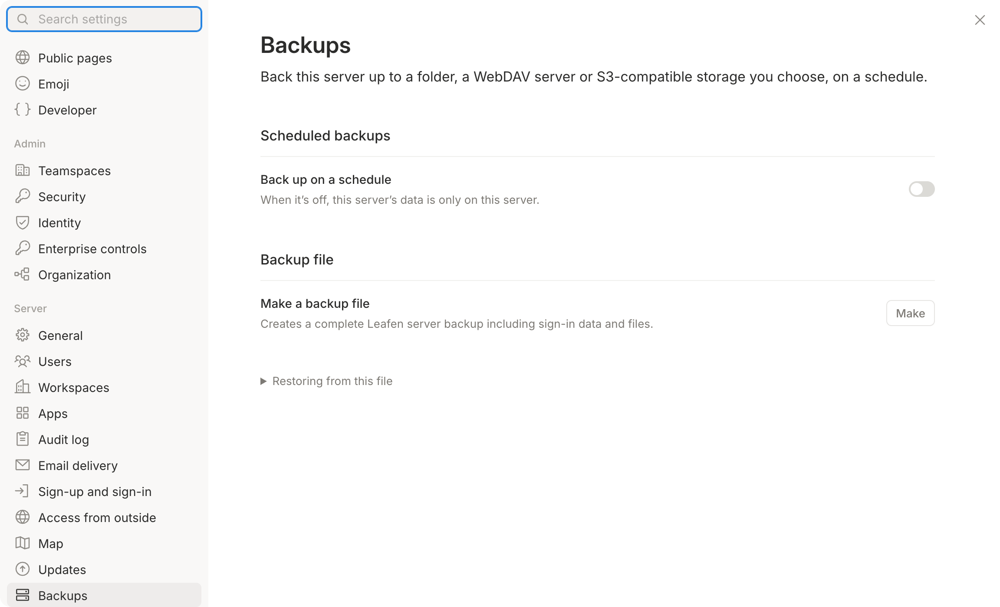

# Backups

<!-- guide-sources:
web/src/components/admin/AdministratorScheduledBackup.tsx
web/src/components/admin/ScheduledBackupSyncFolders.tsx
web/src/components/admin/BackupProtection.tsx
web/src/components/admin/AdministratorBackupRestore.tsx
web/src/components/admin/AdministratorDataManagement.tsx
web/src/components/admin/ReplicationSetting.tsx
web/src/components/admin/StandbySetting.tsx
web/src/components/admin/ServerMoveSetting.tsx
web/src/components/auth/SetupRestore.tsx
web/src/locales/en/serverConsole.json
web/src/locales/en/authGate.json
internal/app/scheduled_backup_settings.go
internal/app/scheduled_backup_runner.go
internal/app/scheduled_backup_suggestion.go
internal/app/scheduled_backup_protection_settings.go
internal/app/scheduled_backup_restore_requests.go
internal/app/setup_restore.go
internal/app/administrator_backup.go
-->

This chapter is for a server's administrators. It shows how to back Leafen up
from its settings, how to bring a backup back on the same server, and how to
start a new server from the backups of one you lost. Backups made with the
`leafen backup` command, the backup environment variables, what a snapshot
holds and how it is encrypted are in
[Self-hosting: Backup](../self-hosting.md#backup) and
[Self-hosting: Restore](../self-hosting.md#restore). A page's own earlier
versions are in Page history, and pages in the trash in Trash; neither needs a
backup.

Leafen keeps no backups for you anywhere. Until you turn them on, a server's
pages and files are only on that server.

## Who sees these settings

The **Server** part of Settings (the workspace name in the sidebar →
**Settings**) shows only to the server's administrators. The person who set
the server up is its first administrator. Three of its pages are about
backups:

- **Backups**: scheduled backups, their protection, and a one-off backup file.
- **Standby server**: continuous replication and a second server that takes
  over.
- **Restore and move**: going back to a backup, and moving the whole server.

## Turn on scheduled backups



1. Open Settings → Server → **Backups**.
2. Turn on **Back up on a schedule**.
3. Under **Back up to**, choose where:
   - **A folder**: type the folder's full path in **Backup folder**. The folder
     must already exist, must be outside the server's data folder, and the
     server must be able to write to it. A cloud drive's synced folder, a NAS
     share or an external disk keeps a copy away from this computer. In the
     desktop app, **Choose folder…** opens the system's folder picker. A
     server in a container can't write to a path of the computer it runs
     on: give `/backups`, the place mounted for backups, or a folder in it
     ([Self-hosting: Backup](../self-hosting.md#backup)).
   - **A WebDAV server**: the **WebDAV address** of a folder on a server such
     as Nextcloud or Synology, its **User name** and **WebDAV password** (an
     app password, where the server offers one).
   - **S3-compatible storage**: **Endpoint**, **Region**, **Bucket**,
     **Prefix (optional)**, **Access key** and **Secret key**, and **Use
     path-style addresses** for storage such as MinIO. Give the keys access to
     that bucket only.
4. Choose **How often** (**Every 6 hours**, **Every 12 hours**, **Every day**
   or **Every week**) and **Backups to keep** (1 to 365).
5. Press **Save**.

The first backup starts as soon as you save. **Backup status** then shows the
**Last backup** — with its size, its files, what it sent new and how long it
took — the **Next backup** and how many **Backups kept**, and **Back up now**
makes one at once (while one runs, it says so and starts nothing more). Saving
says when it starts a backup: turning backups on or choosing another place
backs up right away. While a backup runs, a bar under **Next backup** shows its
step, the bytes and files gone through of all it has, what it has sent and
about how long is left; a first backup of a large server can take a while.
A file deleted while a backup goes through the data folder is left out of it
and counted on the **Last backup** line.
Restoring and **Make a backup file** show their steps the same way. One that
fails says why — the place missing, its address sending elsewhere, the place
not answering, credentials refused or no room — and, under **Details**, what
the place or the system answered (for example `WebDAV PROPFIND answered 301`). On a
WebDAV server or S3 storage, saving first
writes a test file there, so a wrong address, password or key shows straight
away.

A backup goes into a folder named `Leafen backups` at the place you chose,
one snapshot folder per backup under `Leafen backups/snapshots/`. Files that
did not change are stored once and shared between snapshots.

### Cloud folders in the desktop app

In the desktop app, **Backups** first lists **Cloud folders on this
computer**: the folders of Google Drive, iCloud Drive, Dropbox and OneDrive
that it finds. **Back up here** on one turns scheduled backups on into that
folder, every day, keeping the last 7, and starts the first backup. Keep the
server's own data folder out of a synced folder; only the backups go there.

### When backups are off or failing

- Settings → Server → **General** says so at the top, with **Turn on
  backups**, and Settings → Workspace → **Import** says so before a Notion
  import. Only administrators see these lines.
- A week after the first workspace was made, once it holds a page of your own,
  administrators see a band at the top of the app: **Turn on backups** opens
  these settings, **Dismiss** hides it for every administrator.
- A backup that fails is tried again within the hour, and the settings show
  why. From the second failure in a row administrators see a band, and get a
  mail at most once a day if the server sends mail. Both stop after the next
  backup that works.

## Protect the backups

A backup holds the server's secret keys too. Under **Backup protection** on
the **Backups** page:

- **Make a recovery code** shows a code of 32 letters and digits once. Press
  **Copy** or **Print**, keep it somewhere other than this server, then press
  **I've saved it**.
- **Choose a password instead** sets a password of at least 12 characters
  that is not a common one, with or instead of the code.

From then on every backup is encrypted, and either the code or the password
opens it on any server. Without both, no one can open the backups. **Make a new
recovery code** and **Change password** keep earlier backups readable with the
new one; the old code stops working. One of the two always stays.

A folder on this computer may stay unencrypted. A WebDAV server, S3 storage or
a cloud drive's synced folder takes no backup until a recovery code or a
password exists.

## Make a backup file

**Backup file** on the **Backups** page makes one complete archive of the
server, login data and files included: press **Make**, wait for
**Completed**, then **Download**. The page shows the file's SHA-256; keep it
with the file. A backup file stays on the server for 7 days. A backup file is
restored only with the `leafen restore` command, into an empty data folder
([Self-hosting: Restore](../self-hosting.md#restore)).

## Go back to a backup on the same server

1. Open Settings → Server → **Restore and move** (or **Open** beside
   **Restore from a backup** on **Backups**). **Restore from a backup** lists
   the backups at the backup place, newest first, each with its time and
   size.
2. Press **Restore this backup** on the one you want, then **Restore**.

Everything on the server goes back to that time. On Linux and macOS the
server starts itself again and the page reloads. The desktop app's own server
and a server on Windows restore the next time they start: press **Restart
now** in the desktop app, or close it and open it again. **Don't restore**
cancels a restore that is still waiting for that start.

What the server held just before is kept. Until the next scheduled backup
succeeds, or for 7 days, **Undo the restore (until …)** then **Undo restore**
brings it back.

Devices that were open during the restore show **The server's data
changed**. **Reload from server** loads the restored data; **Later** keeps the
device's copies, and the device sends none of its unsent changes to the
restored server. People may need to log in again.

## Start a new server from a lost server's backups

When a server is lost, set up a new Leafen and fill it from the backups:

1. Install Leafen and open its first-run page (see [Installing Leafen](../install.md)).
2. On **Welcome to Leafen**, press **Restore it from a backup** in the dim
   line under **Continue** ("Used Leafen before?").
3. Choose the **Backup place** — **A folder on this computer**, **WebDAV** or
   **S3-compatible storage** — and fill in its path or address and login
   details. For a folder, give the folder that holds `Leafen backups`, or
   `Leafen backups` itself. A server in a container offers **A folder in the
   container** instead, since it can't read a path of the computer it runs
   on: give `/backups`, the place mounted for backups, or the folder in it
   that holds `Leafen backups`. Put the lost server's backups there first,
   for example by mounting their folder at `/backups`
   ([Self-hosting: Backup](../self-hosting.md#backup)).
4. Press **Find backups**. The continuous replica, if there is one, is listed
   first, then each backup. Encrypted backups show **Can't be opened yet**:
   type the **Backup password or recovery code** and press **Open**.
5. Choose one and press **Restore**.

The server starts again on the restored data, and this browser comes in as the
restored server's owner account. Everyone else logs in as before. The
restored server keeps the lost server's backup settings and goes on backing
up to the place you restored from; a folder place takes the path you typed
here.

### Leave it to an agent

On the same screen, **Leave it to an agent** hands the steps to an agent
such as Claude Code, Codex, Claude or ChatGPT:

1. Say where the agent is. **On this computer** (Claude Code, Codex) opens
   nothing to the outside. **Somewhere else** (a chat app, on the web) first
   opens access from outside for the restore alone: **Open a one-time link**
   (no account, through Cloudflare) or **Open with Tailscale** (a free
   account; its device for the restore goes away afterwards). A server that
   is reached from the internet already skips this.
2. Press **Copy text** and paste it to the agent. Its one-time code does this
   restore only, and stops once the restore is done or in 30 minutes; the
   agent finds the backups, asks which one, and restores it.
3. When the agent says so, type the backup password or recovery code, or the
   storage's password or keys, in the fields that show under **Type these
   here yourself**, and press **Save**. The agent never sees them.

When the agent restores, the server starts again on the restored data and
this browser comes in as its owner, as above; any access from outside opened
for the restore closes. **Stop** ends the code and goes back.

### Restore with the command

To restore without a screen, or a backup file, use the `leafen restore`
command. **Restoring without this screen** on **Restore and move** shows it
too. It fills a new, empty data folder; for a backup in a folder, name the
snapshot's folder, which is named by its time in UTC:

```sh
leafen --dir=<new empty data folder> restore \
  --input="<backup folder>/Leafen backups/snapshots/20261004T010000Z"
```

`leafen` is the server's program, as
[Installing Leafen: The first run by commands](../install.md#the-first-run-by-commands)
names it. Start Leafen on that folder only once the command answers
`"status":"restored"`; to put it at the old server's address and port, stop
the old server first. Its next scheduled backup comes one interval after that
first start, not at once. An encrypted backup takes its recovery code with
`--recovery-code-file` or its password with `--password-file`. A backup on a
WebDAV server or in S3 storage is downloaded whole first, and a backup file
takes the SHA-256 the page showed with `--sha256`
([Self-hosting: Restore](../self-hosting.md#restore)).

## Continuous replication and a standby server

With scheduled backups on, Settings → Server → **Standby server** →
**Continuous replication** (**Send every change to the backup location within
seconds**) sends each change to the backup place within seconds. A server
restored from that replica is a few seconds behind the lost one instead of a
backup interval behind.

On the same page, **Add a standby server** gives a connection code for a
second Leafen server, which pastes it under **Become a standby server**. The
standby follows the replica and takes over by itself when this server stops
answering for 30 seconds; **Take over now** switches at once. The backup place
must show changes to both servers at once, such as S3 or a shared drive. How
the pair decides, and how to update it with a moment's pause, are in
[Self-hosting: Standby server](../self-hosting.md#standby-server).

**Move to another server** on **Restore and move** moves the whole server
rather than restoring a backup. It is described in
[Self-hosting: Moving to another server](../self-hosting.md#moving-to-another-server).

## Names, limits and defaults

| Name | Limit or default | Notes |
| --- | --- | --- |
| Back up on a schedule | Off | Turned on by an administrator, or by `LEAFEN_BACKUP_FOLDER`, `LEAFEN_BACKUP_WEBDAV_URL` or `LEAFEN_BACKUP_S3_BUCKET`; set by the environment, the screen only shows it. |
| How often | Every day | The screen offers every 6 hours, every 12 hours, every day and every week; `LEAFEN_BACKUP_INTERVAL` also takes hours and days. |
| Backups to keep | 7 | 1 to 365. Older backups are deleted. |
| A failed backup | Tried again within 1 hour | A band from the second failure in a row; at most one mail a day. |
| Band suggesting backups | 7 days after the first workspace | Only with a page of your own; until dismissed or backups are on. |
| Recovery code | 32 letters and digits | Shown once. |
| Backup password | At least 12 characters | Not a common password. |
| Undo a restore | 7 days | Or until the next scheduled backup succeeds, whichever is first. |
| Backup file | Kept on the server for 7 days | Restored only with `leafen restore`. |
| Standby takeover | 30 seconds without the primary | Can be turned off; **Take over now** switches at once. |

## For agents and the API

An agent connected with an administrator's key can read and change backups
through the API, as the screen does: `leafen_operations` finds the
operations, such as `/api/leafen/v1/admin/backups/schedule` for the schedule
and `/api/leafen/v1/admin/backups/schedule/restore` for a restore, and
`leafen_call` runs them. A restore asks the person to confirm first.

`leafen_standby` reads how backups, the replica and a standby pair stand and
what is left to do, and `leafen_server_move` follows a whole-server move —
both, as all the server's administration, on an administrator's agent
connection, not an MCP token. An
agent never gets a recovery code, a backup password or a connection code from
them: the person types those into the screens above.

## Differences from Notion

- Notion keeps your data on its own servers. Leafen keeps no copy for you:
  backups go only to a folder, WebDAV server or S3 storage you choose, and they
  are off until an administrator turns them on.
- Notion has no setting to restore a whole workspace to an earlier time.
  Leafen's administrators can take the whole server back to a backup, and undo
  it.

## Related chapters

- [Self-hosting: Backup](../self-hosting.md#backup) and [Restore](../self-hosting.md#restore)
- [Accounts and devices](accounts-and-devices.md)
- [Exporting](exporting.md)
- [Troubleshooting](troubleshooting.md)
