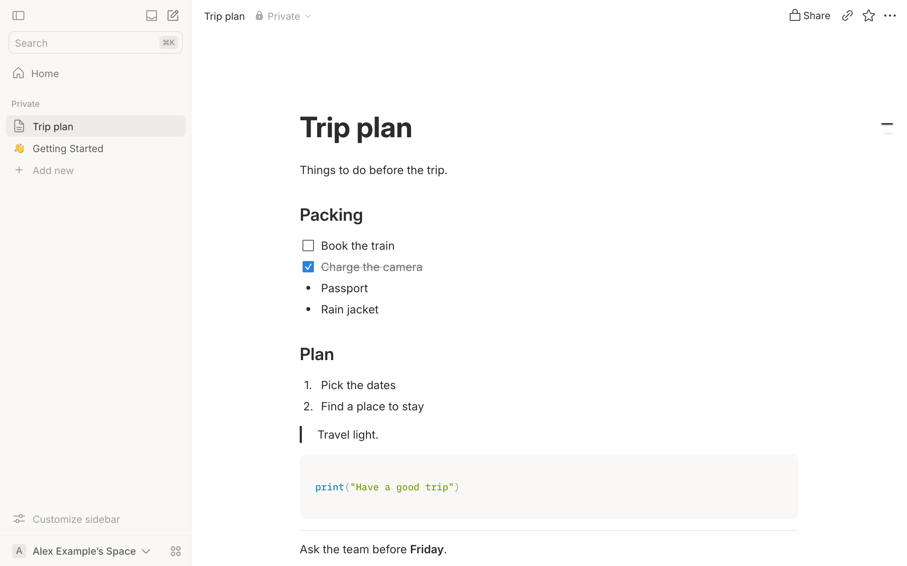

# Editor blocks

<!-- guide-sources:
contracts/content-graph-wire.json
web/src/components/editor/blockDefinitions.ts
web/src/components/editor/databaseSlashDefinitions.ts
web/src/components/editor/inlineSlashDefinitions.ts
web/src/components/editor/slashCommandDefinitions.ts
web/src/components/editor/slashSuggestions.ts
web/src/components/editor/slashHtmlLead.ts
web/src/components/editor/slashBlockPlacement.ts
web/src/components/editor/embedServices.ts
web/src/components/editor/editorInputModel.ts
web/src/components/editor/textBlockInputModel.ts
web/src/components/editor/nativeTiptapInputRules.ts
web/src/locales/en/blocks.json
web/src/locales/en/blockHandle.json
web/src/locales/en/selectionToolbar.json
web/src/codeLanguages.generated.ts
-->

This chapter covers what goes inside a page: every kind of block, the **/**
menu that adds them, the Markdown you can type instead, the block menu and
text formatting. A page itself (title, icon, cover, its menu) is in
[Pages](pages.md). Databases inside a page are only named here; their views
and properties are in the Databases chapters
([Databases](README.md#databases)). Keys are listed in full in
[Keyboard shortcuts](keyboard-shortcuts.md).

## Blocks

Everything in a page's body is a **block**: each paragraph, heading, list
item, image or table is one, and some blocks hold others (a toggle, a column,
a tab). Every block has a type, written below in backticks as Leafen's API
and MCP name it.

- **Enter** ends a block and starts a new one of the same kind (a new list
  item, to-do or paragraph). Enter in an empty list item moves it out one
  level, and at the top level turns it into text. **Shift+Enter** starts a
  new line inside the block.
- **Tab** indents a block under the one above it; **Shift+Tab** brings it
  back out.
- Hovering a block shows **+** (**Click to add a block below**, Option-click
  or Alt-click to add one above) and ⋮⋮ (**Drag to move, click to open
  menu**). Drag ⋮⋮ to move the block, also beside another block to make
  columns.
- Esc selects the block the caret is in; then the arrow keys move the
  selection, Shift with an arrow widens it, and Delete removes what is
  selected.



## The / menu

Type **/** anywhere in the body to open the menu, then type to filter it and
Enter to choose (Esc closes it). The menu lists, in groups:

| Group | Items |
| --- | --- |
| **Suggested** | **HTML**, marked **New**, for the workspace's members; and, once you have used four kinds or more, the ones you choose most. |
| **Basic blocks** | **Text**, **Heading 1** to **Heading 4**, **Bulleted list**, **Numbered list**, **To-do list**, **Toggle list**, **Page**, **Callout**, **Quote**, **Table**, **Divider**, **Link to page** |
| **Media** | **Image**, **Video**, **Audio**, **Code**, **File**, **Web bookmark** |
| **Database** | **Table view**, **Board view**, **Gallery view**, **List view**, **Timeline view**, **Calendar view**, **Feed view**, **Dashboard view**, **Map view**, **Vertical bar chart**, **Horizontal bar chart**, **Line chart**, **Donut chart**, **Number chart**, **Form**, **Database - Inline**, **Database - Full page**, **Linked view of data source** |
| **Advanced blocks** | **Table of contents**, **Block equation**, **Button**, **Breadcrumb**, **Synced block**, **Toggle heading 1** to **Toggle heading 4**, **2 columns** to **5 columns**, **Code - Mermaid**, **Tabs** |
| **Inline** | **Mention a person**, **Mention a page**, **Date or reminder**, **Emoji**, **Inline equation** |
| **Embeds** | **Embed**, **HTML**, **PDF**, and the services Leafen can draw: **Google Drive**, **Google Maps**, **Figma**, **Miro**, **Excalidraw**, **Loom**, **Typeform**, **CodePen**, **Replit** |
| **Import** | **CSV**, **Text and Markdown**, **Word**, **ZIP**, **PDF** |
| **Turn into** | The kinds the current block can become. |
| **Actions** | **Copy link to block**, **Duplicate**, **Move to**, **Delete**, **Present from here** |
| **Text color** and **Background color** | The ten colors (below). |

Installed apps add their own blocks and actions to the menu, marked **App**
with the app's name.

Where the chosen block goes depends on the line the **/** was typed in:

- In an empty line, the block takes the line's place: **/quote** on an empty
  line makes that line a quote.
- In a line with words, a block kind's own row adds a new block after the
  line, which keeps its words. To change the line itself, choose the kind
  under **Turn into**; filtered, it is the row that ends in **Turn into**,
  such as "Bulleted list · Turn into" below "Bulleted list".

The **+** beside a block opens the same menu and always adds after the
block. The block menu's **Turn into** and the keys in
[Keyboard shortcuts](keyboard-shortcuts.md#turn-a-block-into-another-kind)
also change a block's kind.

## Markdown shortcuts

Type these at the start of a line, followed by a space where shown:

| Type | To get |
| --- | --- |
| `#` `##` `###` `####` then space | Heading 1 to Heading 4 |
| `-`, `*` or `+` then space | Bulleted list |
| `1.` or `1)` then space (any number) | Numbered list, starting at that number |
| `a.` or `i.` then space | Numbered list with letters or roman numerals |
| `[]` then space | To-do list (`[x]` starts it checked) |
| `>` then space | Toggle list (at the start of a heading: a toggle heading) |
| `"` then space | Quote |
| ```` ``` ```` | Code |
| `---` | Divider |

Within a line:

| Type | To get |
| --- | --- |
| `**text**` or `__text__` | **Bold** |
| `*text*` or `_text_` | *Italic* |
| `~text~` or `~~text~~` | Strikethrough |
| `` `text` `` | Inline code |
| `$$x^2$$` | Inline equation |
| `[words](https://example.com)` | A link |
| `--` | — |
| `->` `<-` `<->` `=>` | → ← ↔ ⇒ |
| `>=` `<=` `!=` | ≥ ≤ ≠ |
| `...` | … |

Straight quotes typed in text become curly quotes. A shortcut typed inside
inline code stays as typed.

## The block menu

⋮⋮ beside a block (or Cmd+/, Ctrl+/ with the block selected) opens its menu,
with **Search actions…** at the top. It offers, as the block allows:

- **Turn into** — another kind of block; text blocks also turn into **Page**
  (a sub-page holding the block) or **Page in** (a page you choose);
- **Color** — text or background color;
- **Copy link to block**, **Duplicate** (Cmd+D), **Move to** (to another
  page), **Delete**;
- **Comment** (Cmd+Shift+M) and **Suggest edits**;
- for a list, **List format** (**Disc**, **Circle**, **Square**, or
  **Numbers**, **Letters**, **Roman numerals**); for a quote, **Quote size**;
  for code, **Copy code**, **Wrap code**, **Language** and **Format code**;
  for a table, **Header row**, **Header column** and **Fit to width**; for
  media, **Caption**, **Alt text**, **Align**, **Replace**, **Download**;
- **Present from here**.

Its foot names who edited the block last and when.

## Text formatting

Select words to show the formatting toolbar: **Turn into**, **Bold**
(Cmd+B), **Italicize** (Cmd+I), **Underline** (Cmd+U), **Strike-through**
(Cmd+Shift+S or Cmd+Shift+X), **Mark as code** (Cmd+E), **Mark as equation**
(Cmd+Shift+E), **Add link** (Cmd+K), **Text color**, **Comment**, **React to
selected text** and **Suggest edits**. Cmd+Option+\\ clears formatting.

The colors are **Default**, **Gray**, **Brown**, **Orange**, **Yellow**,
**Green**, **Blue**, **Purple**, **Pink** and **Red**, each as text or as a
background. Cmd+Shift+H applies the color used last.

On Windows and Linux, Ctrl takes the place of Cmd and Alt of Option.

## Text and headings

### Text (`paragraph`)

A plain paragraph: **/text**, or simply type. An empty one shows "Press / to
insert blocks".

### Heading 1 (`heading_1`)

A big section heading: **/h1** or `#` and a space. Cmd+Option+1 turns a block
into it.

### Heading 2 (`heading_2`)

A medium section heading: **/h2** or `##` and a space (Cmd+Option+2).

### Heading 3 (`heading_3`)

A small section heading: **/h3** or `###` and a space (Cmd+Option+3).

### Heading 4 (`heading_4`)

A smaller section heading: **/h4** or `####` and a space.

### Toggle heading 1 (`toggle_heading_1`)

A large heading whose blocks fold under it: **/Toggle heading 1**, or `>`
and a space at the start of a heading 1.

### Toggle heading 2 (`toggle_heading_2`)

A medium heading that folds: **/Toggle heading 2**.

### Toggle heading 3 (`toggle_heading_3`)

A small heading that folds: **/Toggle heading 3**.

### Toggle heading 4 (`toggle_heading_4`)

A smaller heading that folds: **/Toggle heading 4**.

### Quote (`quote`)

A quotation: **/quote** or `"` and a space. Its block menu sets **Quote
size**.

### Callout (`callout`)

A box that makes words stand out: **/callout**. It starts with 💡 on a gray
background; choose the icon to change it, and its color in the block menu.

### Divider (`divider`)

A line between blocks: **/divider** or `---`.

## Lists

### Bulleted list (`bulleted_list_item`)

**/bullet** or `-` and a space (Cmd+Option+5). **List format** in the block
menu picks **Disc**, **Circle** or **Square**.

### Numbered list (`numbered_list_item`)

**/number** or `1.` and a space (Cmd+Option+6). Typing another number starts
the list from it; `a.` and `i.` start lettered and roman lists. **List
format** picks **Numbers**, **Letters** or **Roman numerals**.

### To-do list (`to_do`)

A checkbox and its words: **/todo** or `[]` and a space (Cmd+Option+4).
Choose the box to check it; checked items are struck through.

### Toggle list (`toggle`)

A line whose blocks fold under it: **/toggle** or `>` and a space
(Cmd+Option+7). Choose ▸ to open or close it; Cmd+Option+T opens or closes
every toggle on the page.

## Pages and links

### Page (`child_page`)

A sub-page inside this page: **/page** (Cmd+Option+9 turns a block into
one). The block shows the sub-page's icon and title and opens it. Moving or
deleting the block moves or deletes the sub-page ([Pages](pages.md)).

### Link to page (`link_to_page`)

A link to a page somewhere else: **/link to page**, then choose the page. It
shows the page's current icon and title.

### Breadcrumb (`breadcrumb`)

The current page's place, as a row of links to the pages above it:
**/breadcrumb**. At the workspace's top it reads "No parent pages".

### Table of contents (`table_of_contents`)

An outline of the page's headings that links to each: **/toc**. With no
headings it says "The table of contents fills in once the page has headings."

## Tables and layout

### Table (`table`)

A simple table of text cells, not a database: **/table**. It starts with 3
rows and 3 columns. Hover its edges to add a row or column, or drag to add
or remove several; each row's and column's handle offers **Insert above**,
**Insert below**, **Insert left**, **Insert right**, **Duplicate**, **Clear
contents**, **Delete** and **Color**, and chosen cells **Merge cells**. The
block menu turns on **Header row** and **Header column**.

### Table row (`table_row`)

One row of a table; it is made with the table and with its rows' handles, not
from the menu.

### Columns (`column_list`)

Blocks side by side: **/2 columns** to **/5 columns**, or drag a block beside
another. Drag the gap between columns to change their widths.

### Column (`column`)

One column of a column list; columns are made with the list and by dragging.

### Tabs (`tab`)

Content in tabs: **/tabs**. It starts with **Tab 1**, **Tab 2** and **Tab 3**;
**+** adds one. Each tab's menu offers **Rename**, **Edit icon**, **Copy
link** and **Delete**. An empty tab says "This tab is empty. Click or drag
blocks in."

## Code and math

### Code (`code`)

Code with syntax highlighting: **/code** or ```` ``` ```` (Cmd+Option+8).
Its **Language** list has 87 languages, and plain text. The block menu holds
**Copy code**, **Wrap code**, **Language** and **Format code**. **/Code -
Mermaid** starts a code block in Mermaid, drawn as a diagram. Math does not
apply to words in a code block.

### Block equation (`equation`)

A standalone TeX equation: **/equation**. Choose it to edit the TeX; the
equation is drawn as you type. An inline equation inside a line is
**/Inline equation**, `$$…$$` or Cmd+Shift+E on selected words.

## Media and files

### Image (`image`)

**/image** opens **Add an image**: **Upload** a picture, or paste its
address under **Link** ("Paste the address of any image online."). A picture can
be aligned **Left**, **Center** or **Right**, cropped, given a caption and alt
text, opened full screen, downloaded or replaced.

### Video (`video`)

**/video** opens **Embed or upload a video**: upload one, or paste a link
("Works with YouTube, Vimeo, and more").

### Audio (`audio`)

**/audio** opens **Add an audio file**: upload one, or paste a link ("Supports
MP3, WAV and OGG files").

### File (`file`)

**/file** opens **Upload or embed a file**: upload a file, up to 5 GiB, or
paste a link. The block shows the file's name; Office, PDF and Hangul files
open in a preview, and others download.

### PDF (`pdf`)

**/pdf**: a PDF shown in the page, from an upload or a link, with its own
page controls and full screen.

### Web bookmark (`bookmark`)

**/bookmark**: a link shown as a card with the page's title, description and
picture.

### Link preview (`link_preview`)

A link card kept from a Notion link preview, shown as a link card. Leafen
does not fetch the provider's live preview, and the menu does not make it.

### Embed (`embed`)

**/embed**, or a service by name: a web page or a service's content drawn in
the page. Leafen lists only the services it can draw from their link; a link
it cannot draw becomes a bookmark instead. **HTML** embeds an uploaded HTML
file in a sandboxed frame, marked as user HTML; an organization can turn
these off.

## Databases

### Database - Inline (`inline_database`)

A database inside the page: **/Database - Inline**, or a view by name
(**Table view**, **Board view** and the others in the menu's **Database**
group). It opens with a start window to choose a new or an existing data
source. Databases are described in the Databases chapters
([Databases](README.md#databases)).

### Database - Full page (`child_database`)

A database that is a sub-page of its own: **/Database - Full page**.

## Advanced

### Synced block (`synced_block`)

Content kept the same in several places: **/synced block**, put blocks in it,
then copy it and paste it into another page. Editing any copy changes all of
them. The block menu's **Unsync** turns one copy into ordinary blocks, and
**Unsync all** (Cmd+Shift+G) does it for every copy. Deleting the original
keeps the copies' content.

### Button (`button`)

A button that runs steps when pressed: **/button**. Its steps include
**Insert blocks**, **Add page to…**, **Edit pages in…**, **Send
notification**, **Show confirmation**, **Open page** and **Open URL**; they are
described in [Automations and buttons](automations-and-buttons.md).

### Template (`template`)

An old Notion template button kept from an import. Pressing it adds a copy of
the blocks it holds; the menu does not make new ones (use **Button**).

## Names, limits and defaults

| Name | Limit or default | Notes |
| --- | --- | --- |
| Text in one block | Up to 200,000 characters | |
| New table | 3 × 3 | |
| New tabs block | 3 tabs | |
| New callout | 💡, gray background | |
| Columns from the menu | 2 to 5 | |
| Code languages | 87, and plain text | |
| File upload | Up to 5 GiB a file | |
| Comment attachments | Up to 3 files a comment | See [Mentions and comments](mentions-and-comments.md). |

## For agents and the API

- `notion-update-page` replaces or inserts page content as Markdown
  (`replace_content`, `insert_content`, `update_content`);
  `notion-create-pages` takes Markdown for new pages. Each block type above
  has its Markdown form, which `notion-fetch` writes back.
- `leafen_get_file` and `leafen_replace_file` read and replace a page's
  files; `notion-create-file-upload` and `notion-create-attachment` add new
  ones.
- See the [MCP reference](../../MCP.md) and
  [Building on Leafen](../developers.md).

## Differences from Notion

- Leafen has no built-in AI: the menu has no AI blocks, and **HTML** takes an
  uploaded file only.
- The **Embeds** group lists only the services Leafen can draw from a link.
- The image window has no GIPHY tab.
- Math does not apply to words in a code block.
- Deleting a synced block's original keeps its copies' content.
- A database made with **/** always opens its start window.

## Related chapters

- [Pages](pages.md)
- [Keyboard shortcuts](keyboard-shortcuts.md)
- [Mentions and comments](mentions-and-comments.md)
- [Databases](README.md#databases)
