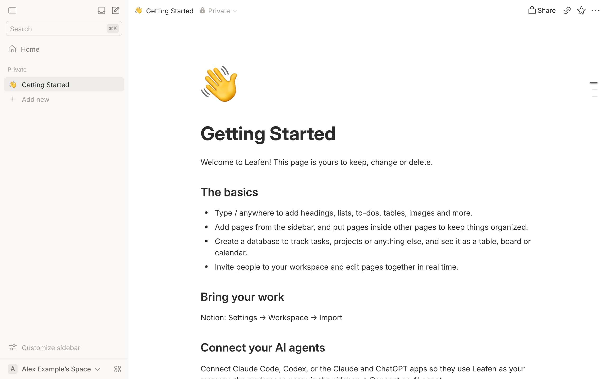

# Getting started

<!-- guide-sources:
web/src/components/auth/AuthGateScreen.tsx
web/src/components/auth/AuthenticatedAccountGates.tsx
web/src/components/auth/SignInWays.tsx
web/src/components/firstSetup/FirstRunSteps.tsx
web/src/components/firstSetup/AgentConnectStep.tsx
web/src/components/firstInstall/FirstInstall.tsx
web/src/components/sidebar/SidebarPageSections.tsx
web/src/components/sidebar/AddPageWindow.tsx
internal/app/workspace_welcome_page.go
internal/app/workspace_welcome_text.generated.go
-->

This chapter takes you from a Leafen that has just been installed to your
first page: the first run's screens, the workspace they open, and the first
things to do there. Installing Leafen itself — the desktop app, Docker or a
build from source — is in [Installing Leafen](../install.md), which also shows
an agent how to do the first run by commands. What the words workspace, page
and teamspace mean is in [Concepts](concepts.md).

## The first run

The first run asks three things and then opens your workspace. An agent can
answer the same questions by commands instead
([The first run by commands](../install.md#the-first-run-by-commands)); a
Leafen window that is open follows each step it finishes.

1. **Welcome to Leafen.** In the desktop app, choose **Start new on this
   computer** first (**Log in** is for a Leafen you already use). On a
   server, open it from its own network (the same computer, a home or
   office network, Tailscale) — no code is asked there — or open the setup
   address the server printed ([Docker](../install.md#docker)), whose
   one-time code comes with it. Opened from the outside internet without
   that address, the page says where to find it instead; a server started
   with a setup code (a hosting template makes one) asks for it under the
   name, with where it is. Type your **Name** over the made-up one filled in —
   "Others see you by this name. You can change it any time." — and choose
   **Continue**. You are the first
   person here, so you look after this Leafen: you are its administrator and
   the owner of its first workspace. No email or password is asked for; you
   can add one later in Settings › Account (the row with your name) as a
   backup way to log in.
   The dim line under it, "Used Leafen before? **Restore it from a
   backup**", is for bringing back a Leafen you used on another computer,
   yourself or left to your agent
   ([Backups](backups.md#start-a-new-server-from-a-lost-servers-backups)).
2. **Language.** Choose the language Leafen uses and choose **Continue**. You
   can change it later in Settings › Preferences
   ([Language and time](language-and-time.md)).
3. **Open Leafen from anywhere?** For phones, the people you work with and AI
   apps on the internet to reach Leafen, it needs an internet address of its
   own. **Make an address with Tailscale** is the recommended way; **Other
   ways** holds **Use my own domain** and **Try it for a while, no account**.
   **Later** leaves it as it is. A server started with an address of its own
   (`LEAFEN_PUBLIC_URL`) shows that address here instead, with **Done**. The
   ways are explained in [Outside address](outside-address.md).
4. **Connect your AI agents.** **Copy text** copies a text you paste into an
   agent such as Claude Code or Codex, and the agent connects itself; the
   step goes on once Leafen sees it connected. **Later** skips it: you can
   connect one any time from the workspace name in the sidebar › **Connect an
   AI agent** ([Agents](agents.md)).

The workspace then opens on its welcome page. A step left for **Later**
waits in Settings › **Preferences** › **Install** › **Finish what was skipped
at install**.

## Your workspace

A Leafen you started yourself has one workspace, named after you: a person
named Alex Example gets **Alex Example’s Space**. Its first page, **Getting
Started** (👋), is a private page with a few lines on typing **/**, adding
pages, databases, inviting people, importing from Notion and connecting
agents. It is yours to keep, change or delete. A workspace made by importing
from Notion starts without it.

The sidebar on the left holds, from the top: **Close sidebar**, **Inbox** and
**New**; the **Search** field; **Home**; your pages under **Private**; and at
the foot the workspace name, which opens the workspace menu. Each part is
described in [The interface](interface.md).

## Make your first page

1. In the sidebar, choose **New** (the pencil at the top) and then **Page**.
   A new page opens in full, its title field ready: the sidebar lists it
   under **Private** as **New page** until you name it.
2. Type a title and press Enter: the caret moves into the page.
3. Type. Each paragraph is a block. Type **/** to choose another kind of
   block — a heading, a to-do, a table, an image, a database — from the menu,
   or start a line with a Markdown shortcut such as `#` for a heading, `-` for
   a bullet or `[]` for a to-do.

The **+** beside **Private** (**Add a page**) also makes a page at once.
While the Private section lists two pages or fewer, it ends with **Add new**,
which opens the add window instead: **Empty page**, **Empty database**, the
workspace's **Existing data sources** and database **Templates**, with **Add
to** at its top to choose where it goes. **New** › **Database** opens the same
window for a database.

An empty new page shows **Get started** at its foot, with **Database**,
**Form** and **More starter options**, to turn it into a database or a form
instead of writing in it.

The page's own parts (icon, cover, sub-pages and its menu) are in
[Pages](pages.md); every kind of block and shortcut is in
[Editor blocks](editor-blocks.md).

## Invite someone

1. Open the workspace name in the sidebar › **Invite members**. The **Add
   members** window opens.
2. Type or paste emails, separated by commas, and pick each from the list.
3. Under **Select role**, keep **Member** or choose **Restricted member**,
   who sees only what they made or what is shared with them. Add a
   **Message** if you like.
4. Choose **Send invite**.

On a server that sends no mail, the invitation is still made: Settings ›
People lists the address as **Invitation pending**, with **Copy link** to
pass the invite link on yourself. For someone without an email, **Invite by
name** at the foot of the same window makes a link for one person, used once
within 7 days. Whoever opens an invitation chooses a name and a language and
is in. Roles,
invitations and teamspaces are in
[Workspaces and members](workspaces-and-members.md); sharing a single page
with someone outside the workspace is in
[Sharing and permissions](sharing-and-permissions.md).

## Log in on another device

Leafen logs devices in with a one-time code from a device that is already
logged in, not with a password.

1. On the logged-in device, open the workspace name in the sidebar › **Add a
   device**. It shows a QR code and a code of twelve digits, such as
   `1234-5678-9012`. The code works once, for 10 minutes; a new one appears
   before it runs out, and **Done** ends it.
2. On the new device, open Leafen's address (or the phone app) and choose
   **Log in with a code** at the top of the login screen. Type the code, or
   choose **Scan a QR code** where the device has a camera.

The line under that button always says where the code comes from: "Get a
code on a logged-in device: sidebar → workspace name → Add a device." Right
under it is **Log in with AI**, where an agent connected to Leafen approves
the login the browser shows. Below that the screen offers **Log in with
email**, **Log in with a passkey**, **Continue with** each login provider
the server has, and **Log in with your company account**, for accounts that
have them. With no logged-in device, an administrator makes a code
on the server ([Self-hosting](../self-hosting.md#logging-in-on-another-device)).

## Names, limits and defaults

| Name | Limit or default | Notes |
| --- | --- | --- |
| Setup code | Printed in the setup address after `#code=`, or `LEAFEN_SETUP_CODE` (at least 8 characters) | Asked only from the outside internet; from the server's own network (the same computer, a private network, Tailscale) the setup takes a name alone. Wrong codes are limited by address. |
| Name | Asked once; changed in Settings › Account | The only thing the first run needs. |
| Language | The browser's language until you choose; 58 languages | Settings › Preferences › Language. |
| Workspace name | `<your name>’s Space`, up to 65 characters | Changed in Settings › General. |
| Welcome page | **Getting Started**, private, in your language | Only in a workspace that starts empty. |
| Device code | 12 digits, works once, 10 minutes | From **Add a device**; an account holds up to 5 at once, a sixth ending the oldest. |
| Invitation by email | 7 days | Settings › People shows it with **Copy link** and **Cancel invitation**. |
| Invitation by name | One person, once, 7 days | Settings › People › **Add members** › **Invite by name**. |

## For agents and the API

- An agent installs Leafen the way
  [Installing Leafen](../install.md#for-agents) says, looks around it in a
  browser of its own when asked to try it, and takes the person through the
  first run with `leafen setup start`, `leafen setup status` and the other
  `leafen setup` commands.
- `notion-create-pages` makes pages (at the workspace's top as private pages,
  or under a page, database or teamspace) with Markdown content.
- `notion-get-setup-guide` gives the guide the server hands every agent when
  it connects.
- `leafen account device-code` on the server makes a login code for an
  account, for a person with no logged-in device or for an agent's own
  browser ([Installing Leafen](../install.md#for-agents)).

## Differences from Notion

- Leafen asks for no email at the start: a name is enough, and an email,
  password or passkey can be added later as a backup way in.
- A new device logs in with a one-time code or QR code from a device that is
  already logged in; Notion logs every device in with its email code,
  password, passkey or SSO.
- The first run asks for an internet address for the server and offers to
  connect your own AI agents. Leafen has no built-in AI.

## Related chapters

- [Concepts](concepts.md)
- [The interface](interface.md)
- [Pages](pages.md)
- [Editor blocks](editor-blocks.md)
- [Workspaces and members](workspaces-and-members.md)
- [Language and time](language-and-time.md)
