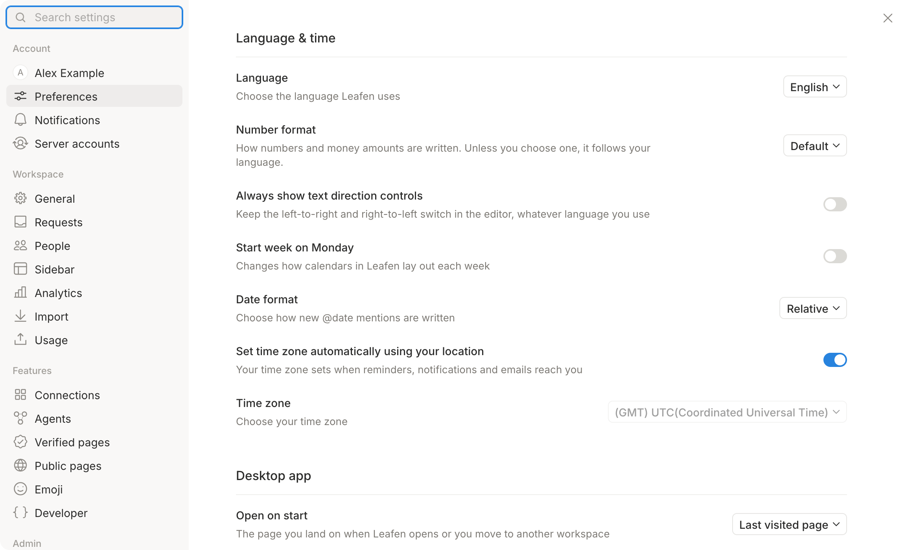

# Language and time

<!-- guide-sources:
web/src/components/account/AccountPreferences.tsx
web/src/lib/displayPreferences.ts
web/src/i18n/languages.ts
web/src/authWire.generated.ts
web/src/lib/timeZones.ts
web/src/locales/en/workspaceSettingsDialog.json
web/src/locales/en/blockItem.json
-->

This chapter covers your own language, number and date formats, the first day
of the week and your time zone. They are personal: each person sets their own
in Settings › **Preferences**, and they follow the account to every device.
Theme and the other preferences are in [The interface](interface.md#settings).

## Language

Settings › **Preferences** › **Language & time** › **Language** sets the
language Leafen's screens use. It lists 58 languages and **System**, which
follows the device's language. The first run asks for it once
([Getting started](getting-started.md)); before you log in, the login
screens follow the browser's language.

The 58 are: 한국어, English, 日本語, 简体中文, 繁體中文, Español, Français, Deutsch,
Português (Brasil), Português (Portugal), Italiano, Nederlands, Svenska,
Dansk, Norsk, Suomi, Polski, Čeština, Slovenčina, Magyar, Română, Ελληνικά,
Hrvatski, Српски, Slovenščina, Български, Українська, Русский, العربية,
עברית, فارسی, اردو, हिन्दी, বাংলা, தமிழ், తెలుగు, मराठी, ગુજરાતી, ಕನ್ನಡ,
ਪੰਜਾਬੀ, മലയാളം, नेपाली, සිංහල, Tiếng Việt, ไทย, Bahasa Indonesia, Bahasa
Melayu, Filipino, မြန်မာ, ខ្មែរ, Türkçe, Azərbaycanca, Қазақша, Oʻzbekcha,
Kiswahili, አማርኛ, Afrikaans and Hausa.

Your language also sets the language of the **Getting Started** page in a
workspace you make.

## Numbers

**Number format** sets the separators numbers and currencies show with:
**Default** (your language's), **1,000,000.00** or **1.000.000,00**.

## Dates and the week

- **Date format** sets how a new **@** date mention reads: **Full date**,
  **Short date**, **Month/Day/Year**, **Day/Month/Year**, **Year/Month/Day**
  or **Relative** (such as "Today" or "Tomorrow"), which it starts with. Each
  choice shows today's date in that format. A mention already in a page keeps
  its own format; its menu changes it.
- **Start week on Monday** makes calendars and date pickers start on Monday
  instead of Sunday.

## Time zone

- **Set time zone automatically using your location** (on at first) keeps
  your time zone as your device's. "Your time zone sets when reminders,
  notifications and emails reach you"
- With it off, **Time zone** picks one from a list you can search by city or
  zone; each zone is listed once, under its place name.

Reminders from **@** dates (**Remind me**) arrive at their time in your time
zone. A date with a time can remind you **At time of event** or 5, 10, 15 or
30 minutes, 1 or 2 hours, or 1 or 2 days before; a date without one, at 9:00
AM **On day of event**, or 1 day, 2 days or 1 week before.

## Text direction

**Always show text direction controls** adds **Text direction** (left to
right or right to left) to the block menu whatever language you use.

## Names, limits and defaults

| Name | Limit or default | Notes |
| --- | --- | --- |
| Languages | 58, and **System** | |
| Number format | **Default** | The language's separators. |
| Date format | **Relative** | For new date mentions. |
| Start week on Monday | Off | |
| Set time zone automatically | On | |
| All-day reminder time | 9:00 AM | |
| Always show text direction controls | Off | |

## For agents and the API

Preferences belong to the person, not to a page. The native API reads and
changes them at `/api/leafen/v1/account/display-preferences`
([Building on Leafen](../developers.md)); an agent's key changes them for the
person who made it.

## Differences from Notion

- The time zone list names each zone once; a date imported from Notion with
  an old zone name keeps it.

## Related chapters

- [The interface](interface.md)
- [Mentions and comments](mentions-and-comments.md)
- [Getting started](getting-started.md)
