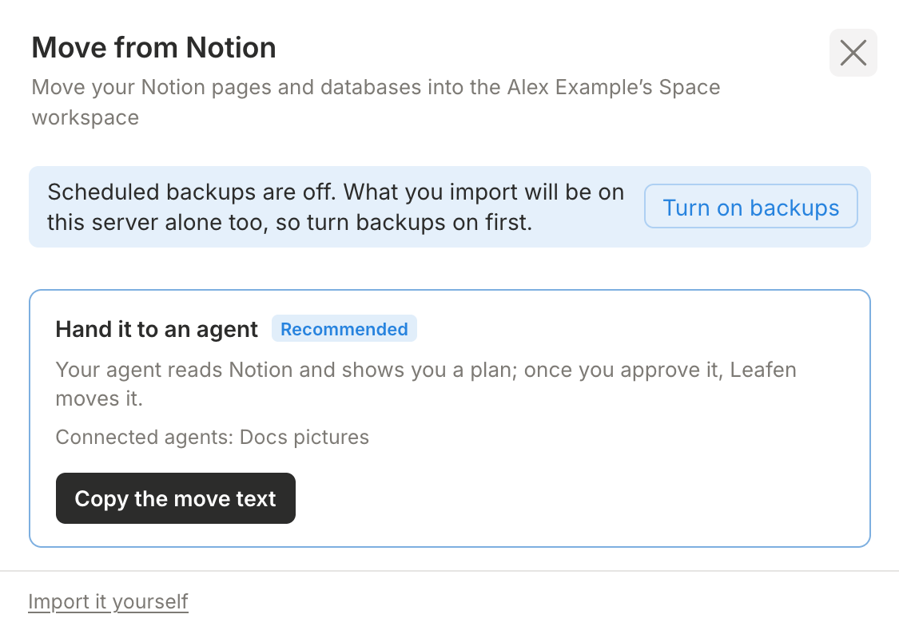

# Moving from Notion

<!-- guide-sources:
web/src/components/import/NotionImportPanel.tsx
web/src/components/import/NotionImportAgentFirst.tsx
web/src/components/ImportedPeopleMapping.tsx
web/src/locales/en/importDialog.json
web/src/components/import/ImportBrowse.tsx
web/src/components/import/ImportHistory.tsx
web/src/locales/en/importedPeopleMapping.json
internal/app/notion_migration_scan.go
internal/app/notion_migration_plan.go
internal/app/notion_migration_run.go
internal/app/imported_people_mapping_apply.go
-->

This chapter shows how to bring a Notion workspace into Leafen: with an agent
that plans the move with you, or by yourself with a Notion token. It also
covers matching Notion's people to Leafen's members and importing again
later. It is for anyone who can import into a workspace. Importing files
(Markdown, CSV, Word, PDF, HTML) and Leafen archives is in the Import section
below; the tools an agent uses are listed in the
[MCP reference](../../MCP.md#moving-a-notion-workspace-on-the-native-endpoint).
What Leafen does differently from Notion after the move is in
[Differences from Notion](differences-from-notion.md).

## Before you start

- Turn on backups first. Before a Notion import, the import screen says so
  when they are off, because what you import will be on this server alone
  ([Backups](backups.md)).
- Leafen reads Notion through a Notion connection's API token. It only reads:
  nothing in Notion changes.
- Keep Notion as it is until you have checked the move. The import report
  lists what didn't come whole; compare those pages with Notion before you
  delete anything there.

## Open the Notion import

Open the workspace name in the sidebar → **Settings** → **Import** (under
**Workspace**), then **Notion** under **Import from elsewhere**. The **Move
from Notion** window offers two ways.

### Hand it to an agent (recommended)

**Hand it to an agent** suits a large or untidy workspace. Your agent reads
Notion, shows you a plan in your conversation, and Leafen moves it once you
approve.

1. If no agent is connected yet, press **Copy the connection text** and paste
   it into your agent (see [Agents](agents.md)). The window shows it once the
   agent connects.
2. Press **Copy the move text** and paste it into the same conversation you
   connected your agent in. If the agent doesn't see Leafen's tools there
   yet, it asks you to type `/reload-plugins` in Claude Code's terminal and
   then send “continue” (Claude Code doesn't go on by itself after it), and
   elsewhere, as in the Claude app or Codex, it calls Leafen over the web
   itself: no new conversation.
3. The agent gets the Notion connection's key Leafen reads through, all in
   the conversation. If it has a browser — yours, as with Claude in Chrome,
   or its own, as in the Claude app, where you log in to Notion once — it
   tells you what it will open and why, asks you once, and in Notion uses
   the connection you made for Leafen before or makes one — read only, with
   all your top pages — and hands its token to Leafen. Otherwise it goes
   through Notion's steps with you and you paste the token into the
   conversation. Only if you'd rather not paste it there, put it in this
   window as in the steps below and press **Save token**: a token saved here
   is kept in Leafen only and never goes to your agent.
4. Go over the plan with your agent: what moves, where it goes, how each
   database's properties come over, and what can't move as it is. Once you
   approve, Leafen runs it, checks the result against Notion and writes a
   report page.

A token that went through the conversation — one the agent made in your
browser, or one you pasted there — the agent passes straight to Leafen. When
the move is done, delete that connection in Notion or make a new token, since
the conversation keeps it.

### Import it yourself

1. Press **Import it yourself**. The window lists the steps **In Notion**;
   **Open Notion token page** opens Notion's developer connections.
2. In Notion, make a connection for Leafen (or open the one you made before),
   keep **API token** as the authentication method, and under **Content
   access** choose the top pages to move. Pages under them come along.
3. Under the connection's **Capabilities**, tick **Read content** and **Read
   comments**. Without **Read comments**, no comments come.
4. Copy the token (it starts with `ntn_`), paste it into **Notion API token**
   and press **Save token**.
5. Choose what to move from **Accessible top-level items**, or search for a
   page or database. Items already moved say **Already moved**.
6. Leafen reads Notion and shows a draft, **Import as is**: how many pages,
   databases and rows move, the **Import location**, and **What can't move as
   it is**. Press **Import**.

You can close the window at any time: the import goes on on the server and
appears under **Completed**. When it is done, **Open the imported page** opens
it and **Open the import report** opens the report page.

## Match Notion's people

People in Notion pages (person properties, mentions, who made or changed a
row) stay as Notion names until they are matched to members here.

1. Invite the people first, so they are members of the workspace.
2. Open Settings → **People** → **Members**, then **Imported people** →
   **Find imported people**. A finished Notion import that kept people by
   their Notion names says how many under **Completed**, and **Open Imported
   people** there opens this place.
3. For each Notion person, choose the member they are, or **Keep as imported
   reference**. Suggestions are marked **suggested**.
4. Press **Apply mapping**. Every value and mention of that person becomes the
   member.

The workspace's owners and administrators map everyone. A member maps the
people in pages they can edit. Only people named in person values or mentions
are listed: a Notion person named only as who made or last changed a page
shows their Notion name there, with nothing to map.

## Import again

Under **Completed**, a Notion import offers **Import changes again**. It reads
Notion again from the start and changes only what changed there: new pages
and rows come, changed ones are updated, and what didn't change keeps its edit
time and editor. Use it while you still work in Notion during the move, and
once more at the end.

An import that stopped offers **Retry**, which goes on from the step it
stopped at without reading Notion again from the start. A canceled one offers
**Import again**; it never makes what it already moved twice.

## Import files

The same **Import** page takes files: drop or choose ZIP, CSV, PDF, text,
Markdown, HTML, Word or EPUB files. Each file becomes its own page, a CSV its
own database, and a ZIP keeps its folders as pages. Formatting, links, tables
and pictures are kept; colors, comments and page layout are not. A Notion
workspace keeps much more through the Notion import above than through a
Notion export file.

**Leafen** restores a workspace exported from Leafen, from a file or from a
running server. Apps move content from other tools such as Obsidian; **Find
more apps** under **Import from other tools** lists them, and
[Leafen workspace bundles](../bundle.md#moving-from-another-tool) shows how they
work.

## Names, limits and defaults

| Name | Limit or default | Notes |
| --- | --- | --- |
| A file to import | 50 MiB | Its text, too. |
| A ZIP to import | 5 GB | Each file inside becomes a page. |
| Notion token | Starts with `ntn_` | Kept encrypted in Leafen and never shown again. |
| Notion capabilities | **Read content** and **Read comments** | Leafen never writes to Notion. |
| Imported people | Kept as Notion names until mapped | Owners and administrators map all; members map pages they can edit. |

## For agents and the API

An agent moves a Notion workspace with the `leafen_notion_migration_*` tools:
`leafen_notion_migration_guide` first, then `leafen_notion_migration_sources`,
`leafen_notion_migration_start`, `leafen_notion_migration_scan`,
`leafen_notion_migration_items`, `leafen_notion_migration_plan`,
`leafen_notion_migration_set_plan`, `leafen_notion_migration_run`,
`leafen_notion_migration_status` and `leafen_notion_migration_verify`. A token the
agent made in the person's browser, after their yes, or one they pasted into
the conversation goes to Leafen with `leafen_notion_migration_connect`. `leafen_notion_migration_formats` reads
what Notion's API leaves out (page widths, fonts, view groups set by hand,
forms) in the person's logged-in Notion. The order and the plan format are in
the [MCP reference](../../MCP.md#moving-a-notion-workspace-on-the-native-endpoint).

## Differences from Notion

- Notion's own importer brings other tools into Notion. Leafen's import reads
  a whole Notion workspace through Notion's API, with its databases, views,
  people and comments, and imports it again as Notion changes.
- Leafen doesn't import people from outside services, so Notion's people are
  matched to members you invite here.

## Related chapters

- [Backups](backups.md)
- [Exporting](exporting.md)
- [Differences from Notion](differences-from-notion.md)
