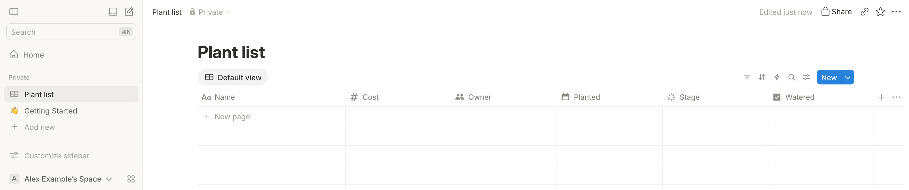

# Properties

<!-- guide-sources:
web/src/components/database/propertyTypes.ts
web/src/components/database/TablePropertyMenu.tsx
web/src/components/database/NumberPropertyConfig.tsx
web/src/components/database/PropertyDateConfig.tsx
web/src/components/database/PropertyDateEditorOptions.tsx
web/src/components/database/PropertyDateDeadline.tsx
web/src/components/database/PropertySelectOptionsConfig.tsx
web/src/components/database/PropertyComputedCells.tsx
web/src/components/database/IdPrefixConfig.tsx
internal/app/database_property_trash.go
internal/app/deadline_values.go
internal/app/file_transfer_wire.generated.go
internal/app/mcp_tool_database_create.go
contracts/content-graph-wire.json
-->

This chapter covers a database's properties: adding, changing and deleting
them, who may see and edit each one, and every property type with its
settings, limits and defaults. It is for anyone who designs a database, and
for agents that change a database's schema through MCP. Making a database is
in [Databases](databases.md), formulas in [Formulas](formulas.md), relations
and rollups in [Relations and rollups](relations-and-rollups.md), and button
properties' actions in [Automations and buttons](automations-and-buttons.md).

## Add a property

1. In a table, press **+** at the end of the column headers, or
   **Add a property** when the table has only its Name column.
2. Type the property's name in "Type property name…", or leave it to take
   the type's name.
3. Choose a type under **Select type**.

The list offers **Text**, **Number**, **Select**, **Multi-select**,
**Status**, **Date**, **Person**, **Files & media**, **Checkbox**, **URL**,
**Phone**, **Email**, **Relation**, **Rollup**, **Formula**, **Button**,
**ID**, **Place**, **Verification**, **Created time**, **Last edited time**,
**Created by** and **Last edited by**. A name the data source already has
gets a number: a second "Owner" is "Owner 1".

You can also add a property from **Settings** › **Edit properties** ›
**New property**, and from a row's page.

## The property menu

Press a column's name to open its menu. It holds the name field and, where
they apply to the type:

| Item | What it does |
| --- | --- |
| **Edit property** | the type's own settings, described under each type below |
| **Property access** | who may see and edit this property ([below](#property-access)) |
| **Change type** | turns the property into another type |
| **Filter**, **Sort**, **Group**, **Calculate** | filter, sort or group the view by it, or show a calculation under the column ([Views](views.md)) |
| **Freeze** | keeps the columns up to this one in place while the table scrolls sideways |
| **Hide** | hides it in this view |
| **Wrap content** | wraps long values onto more lines in this view |
| **Insert left**, **Insert right** | adds a property beside it |
| **Duplicate property** | adds a copy of it right after it |
| **Delete property** | moves it to **Deleted properties** |

The Name column's menu has **Show page icon** instead of **Edit property**,
and it can't be deleted: every data source has exactly one Title property.

### Change a property's type

**Change type** lists the types the property can become. The change applies
at once and converts the values it can: a text "12" becomes the number 12;
text that isn't a number becomes empty. After a change that converts values,
"Property type changed" offers **Undo**, which puts the original values back;
⌘Z (Ctrl+Z) does the same. The original values are kept for 30 days. A change
that would end a two-way relation asks first ("The related database stops syncing
this relation both ways, too"). **ID** shows in the list but can't be
chosen, and an ID property can't change type.

### Delete and restore a property

**Delete property** asks "Delete this property from 〈database〉? It will
disappear from every view." Deleted, the property and its values leave every
view, filter, form and export. **Settings** › **Edit properties** ›
**Deleted properties** lists them, with **Restore** and
**Permanently delete** (which can't be undone) for each, and
**Permanently delete all**. A deleted property stays there until someone
deletes it for good or the database is deleted.

### Property access

**Property access** sets, for one property, what people can do with it:

| Level | Meaning |
| --- | --- |
| **Inherit from database** | each person's access to the database |
| **Can edit property & values** | edit its values and its settings |
| **Can edit values only** | edit its values |
| **Can view property & values** | see it and its values |
| **Can view property only** | see the property but not its values |
| **No access** | not see the property or its values |

**Default access** applies to all people, agents and connections;
**Exceptions** give a person, a group or the people named in a Person
property different access. **Preview as** shows what one person can see.
Press **Save** to keep the rules.

## Names, limits and defaults

| Name | Limit or default | Notes |
| --- | --- | --- |
| Title property | exactly one per data source | It can't be deleted or change type. |
| A title's length | 200,000 characters | A longer paste goes into the page's body. |
| A changed type's original values | kept 30 days | **Undo** after the change brings them back. |
| Deleted properties | kept until deleted for good | |
| Notify days of a deadline date | up to 8, each 0 to 365 days before | Default 7, 3, 1 and 0. |
| A file in Files & media | up to 5 GiB | |
| ID prefix | a letter, then 1 to 9 letters, numbers or hyphens | |
| Number's decimal places | Default, or 0 to 5 | |

## Property types

Each section's heading ends with the name the API and the content contracts
use for the type. In a table, each column's header shows its type's icon:

### Title (`title`)

The row's name, shown as the first column and as the row page's title. Its
column menu has **Show page icon**, which shows each row's icon before its
title in this view. In MCP schemas it is `TITLE`; a schema without one gets
"Name".

### Text (`rich_text`)

Text with formatting, mentions and links. It has no settings. A long value
shows on one line unless **Wrap content** is on. In MCP schemas it is `TEXT`
or `RICH_TEXT`.

### Number (`number`)

A number. **Edit property** has:

- **Number format**: **Number**, **Number with separators**, **Percent**,
  **US Dollar**, **Australian dollar**, **Canadian dollar**,
  **Singapore dollar**, **Euro**, **Pound**, **Yen**, **Ruble**, **Rupee**,
  **Won**, **Yuan**, **Real**, **Lira**, **Rupiah**, **Franc**,
  **Hong Kong dollar**, **New Zealand dollar**, **Swedish krona**,
  **Norwegian krone**, **Mexican peso**, **Rand**, **New Taiwan dollar**,
  **Danish krone**, **Złoty**, **Baht**, **Forint**, **Koruna**, **Shekel**,
  **Chilean peso**, **Philippine peso**, **Dirham**, **Colombian peso**,
  **Riyal**, **Ringgit**, **Leu**, **Argentine peso**, **Uruguayan peso**,
  **Peruvian sol**, **Vietnamese dong**, **Pakistani rupee**,
  **Nigerian naira** or **Bitcoin**. The default is **Number**.
- **Decimal places**: **Default** or 0 to 5.
- **Show as**: **Number**, **Bar** or **Ring**. A bar or a ring has a
  **Color**, **Divide by** (the value that fills it, 100 by default; a
  percent fills it at 1) and **Show number**. "Every view that shows this
  property uses the change."

In MCP schemas it is `NUMBER`, with `NUMBER FORMAT 'dollar'` for a format.

### Select (`select`)

One option from a list. **Edit property** has **Sort** (**Manual**,
**Alphabetical** or **Reverse alphabetical**: the order the options show in)
and **Options**, with **+** to add one. Press an option to rename it, give it
a description, **Delete** it, or choose one of its ten **Colors**: **Default**,
**Gray**, **Brown**, **Orange**, **Yellow**, **Green**, **Blue**, **Purple**,
**Pink** or **Red**. Typing a new value in a cell adds it as an option. In MCP
schemas: `SELECT('Herb':green, 'Shrub':brown)`.

### Multi-select (`multi_select`)

Any number of options from a list, with the same settings as Select. In MCP
schemas: `MULTI_SELECT('Shade':gray, 'Edible':yellow)`.

### Status (`status`)

One option, each in one of three groups: **To-do**, **In progress** and
**Complete**. A new Status property has "Not started" in To-do, "In progress"
in In progress and "Done" in Complete. **Edit property** lists the groups and
their options, with **+** to add one to a group. One option is the
**Default**, which new rows start with; **Set as default** on another option
asks "Change default to “〈option〉”?", and rows whose status was never set
take the new default. The default option can't be deleted ("Cannot delete
default option"). Boards and charts can group by option or by group. In MCP
schemas: `STATUS('Planned':default:to_do, 'Growing':blue:in_progress,
'Harvested':green:complete)`.

### Date (`date`)

A date, with or without a time, or a range with **End date**. The date
editor also has **Include time**, the time zone, and the date and time
formats. **Edit property** has:

- **Date format**: **Full date** (the default), **Short date**,
  **Month/Day/Year**, **Day/Month/Year**, **Year/Month/Day** or
  **Relative**;
- **Time format**: **12 hour** (the default), **24 hour** or **Hidden**;
- **Reminder**, which each new date gets: **None** (the default),
  **On day of event (9:00 AM)**, **1 day before (9:00 AM)**,
  **2 days before (9:00 AM)** or **1 week before (9:00 AM)**.

A date can also be a **Deadline not to miss**, a switch in the date editor.
Its notices go at 9:00 on each of the days set in **Notify days before**
(up to 8 days, each 0 to 365 days before; 7, 3, 1 and 0 by default, 0 being
the day itself) to the row's people and to whoever marked the deadline, in
the inbox and by email when the server
sends email. Until someone acknowledges it, a notice on the deadline's own
day comes again every 3 hours, and an earlier one at 9:00 the next day. The
date editor lists the notices and who acknowledged each, with
**Acknowledge**.

In MCP schemas it is `DATE`.

### Person (`person`)

People and groups of the workspace. **Edit property** has:

- **Limit**: **No limit** (the default) or **1 Person**;
- **Default**: **No default** (the default) or **Creator**, the person who
  makes the row;
- **Notify**: **Users and groups**, **Users only** (the default) or
  **None**: who is notified when added.

In MCP schemas it is `PERSON` or `PEOPLE`.

### Files & media (`files`)

Uploaded files and links to files. A cell's window has **Upload**
(**Upload file**, **Upload folder**, or ⌘V to paste an image) and **Link**
("Paste in https://…"). Each upload is up to 5 GiB; files of active types
(those that could run code when opened) are refused. Each file's menu renames,
downloads or removes it. In MCP schemas it is `FILES`.

### Checkbox (`checkbox`)

Checked or not. It has no settings. Pasted text checks the box for "yes",
"true", "1", "x" and "on". In MCP schemas it is `CHECKBOX`.

### URL (`url`)

A web address. Its column menu has **Show full URL**, which shows the whole
address instead of a shortened one. In MCP schemas it is `URL`.

### Email (`email`)

An email address. In MCP schemas it is `EMAIL`.

### Phone (`phone`)

A phone number. In MCP schemas it is `PHONE` or `PHONE_NUMBER`.

### Created time (`created_time`)

When the row was made. It can't be edited. **Edit property** has
**Date format** and **Time format**, as a Date has. In MCP schemas it is
`CREATED_TIME`.

### Last edited time (`last_edited_time`)

When the row was last changed. It can't be edited. **Edit property** has
**Date format** and **Time format**. In MCP schemas it is `LAST_EDITED_TIME`.

### Created by (`created_by`)

Who made the row. It can't be edited and has no settings. In MCP schemas it
is `CREATED_BY`.

### Last edited by (`last_edited_by`)

Who last changed the row. It can't be edited and has no settings. In MCP
schemas it is `LAST_EDITED_BY`.

### Relation (`relation`)

Rows of another data source, or of the same one. Its settings — the related
data source, **Limit** (**1 page** or **No limit**) and **Two-way relation** —
are in [Relations and rollups](relations-and-rollups.md). In MCP schemas:
`RELATION('〈data source ID〉')`, `RELATION('〈ID〉', DUAL)` for a two-way
relation.

### Rollup (`rollup`)

A value calculated from a property of related rows, through a relation:
[Relations and rollups](relations-and-rollups.md). In MCP schemas:
`ROLLUP('〈relation〉', '〈property〉', '〈function〉')`.

### Formula (`formula`)

A value calculated from the row's other properties: [Formulas](formulas.md).
**Edit property** › **Edit formula** opens the formula editor; a formula that
gives a number also has **Number format**, **Decimal places** and
**Show as**. In MCP schemas: `FORMULA('prop("Cost") * 2')`.

### ID (`unique_id`)

A number Leafen gives each row, counting up from 1 in the order rows are
made, optionally with a prefix ("PL-1", "PL-2"). It can't be edited and its
type can't change. **Edit property** has **Prefix**, with a preview of the
first IDs, and **Add ID Prefix** or **Update ID Prefix**. A prefix starts
with a letter, followed by 1 to 9 letters, numbers or hyphens; a prefix
another ID property of the workspace uses is not available. In MCP schemas:
`UNIQUE_ID PREFIX 'PL'`.

### Button (`button`)

A button in each row that runs actions on that row when pressed. Its column
menu has **Edit automation** instead of **Edit property**. Its actions are in
[Automations and buttons](automations-and-buttons.md). In MCP schemas it is
`BUTTON`.

### Location (`location`)

A place stored by Leafen's earlier location columns. Leafen keeps this type
for data sources that already have it, but nothing fills it in and it can't
be added or chosen in **Change type**; use Place.

### Verification (`verification`)

Whether the row's page is verified, until when and by whom. Adding a
Verification property also adds an **Owner** Person property, whose default is
**Creator**. A cell offers **Verify page** (**Reverify page** once verified):
**For 90 days**, **For 30 days**, **For 7 days**, **Indefinitely** or
**Pick a date** (from tomorrow on), and **Remove verification**. The cell
shows who verified it last. A Verification property can't be made by
changing another property's type. In MCP schemas it is `VERIFICATION`.

### Last visited time (`last_visited_time`)

When the row's page was last opened. Leafen keeps this type for data sources
that already have it, but nothing fills it in and it can't be added.

### Place (`place`)

A point on a map, with a **Name** and an **Address**. A cell opens the
entry fields and a small map: click the map to set the point, or drag it to
move it, or press **Current location** to use where your device is. Nothing
typed leaves the server. Where the server's administrator has set up a place
search provider, a search field ("Search for a location…") is added, and a
search goes to that provider. The map
view shows rows by a Place property ([Views](views.md#map-map)). In MCP schemas
it is `PLACE`.

## For agents and the API

- `notion-update-data-source` changes properties with SQL DDL statements:
  `ADD COLUMN "Cost" NUMBER FORMAT 'dollar'`, `DROP COLUMN "Phone"` (to
  Deleted properties), `RENAME COLUMN "Kind" TO "Type"` and
  `ALTER COLUMN "Notes" SET SELECT('A':red)` (a type change, converting the
  values; select options keep their IDs), given in its `statements`, several
  joined by `;`. `notion-create-database` takes the same type names in its
  `CREATE TABLE` schema, and any column can have `COMMENT 'description'`.
  Property names go in double quotes; option names, formulas, formats and
  other text in single quotes.
- `notion-fetch` on a `collection://` address reads a data source's
  properties with their types and settings.
- `notion-update-page` with `update_properties` sets a row's values.

The type names in schemas are `TITLE`, `TEXT`, `NUMBER`, `SELECT`,
`MULTI_SELECT`, `STATUS`, `DATE`, `PERSON`, `CHECKBOX`, `URL`, `EMAIL`,
`PHONE`, `FILES`, `CREATED_TIME`, `LAST_EDITED_TIME`, `CREATED_BY`,
`LAST_EDITED_BY`, `FORMULA`, `RELATION`, `ROLLUP`, `UNIQUE_ID`, `BUTTON`,
`PLACE` and `VERIFICATION`. See the
[MCP reference](../../MCP.md#notion-compatible-tool-surface).

## Differences from Notion

- After a type change that converts values, Leafen says "Property type
  changed" and offers **Undo**.
- A new property whose name is taken shows the numbered name in its settings
  at once, as its column does.
- Text pasted into a Person or Date cell fills it from a member's name or
  email, or from a date the property's format or ISO 8601 can read; pasted
  "true", "1", "x" and "on" check a Checkbox.
- A Place is picked on a map; place search exists only where the server's
  administrator sets up a provider.
- Dates can be deadlines not to miss, with notices, Leafen's own.
- Property settings have no links to a help center.
- Two people typing in the same text cell both keep their letters.

## Related chapters

- [Databases](databases.md)
- [Views](views.md)
- [Formulas](formulas.md)
- [Relations and rollups](relations-and-rollups.md)
- [Automations and buttons](automations-and-buttons.md)
