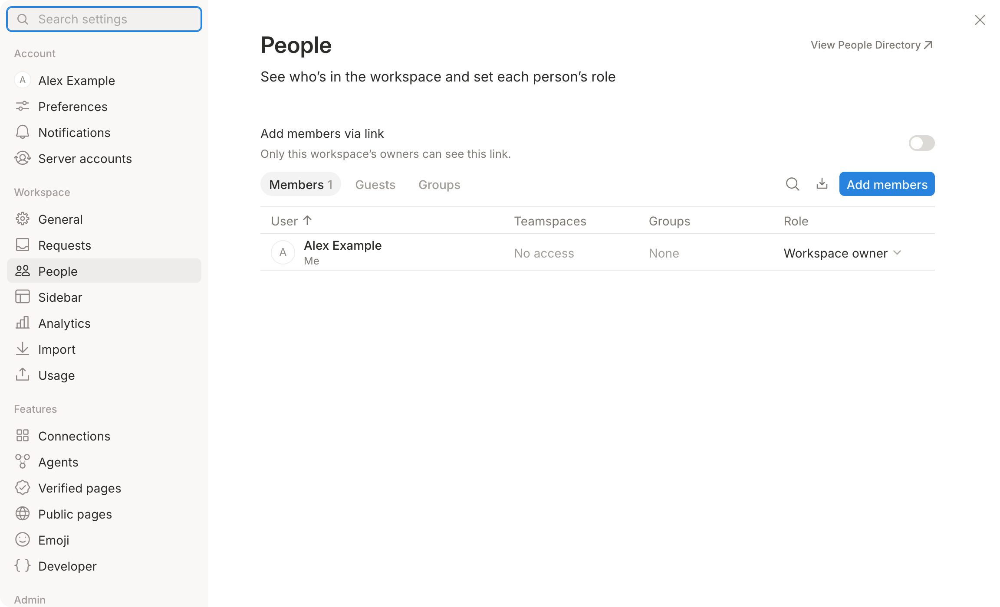

# Workspaces and members

<!-- guide-sources:
web/src/components/WorkspaceCreateDialog.tsx
web/src/components/TeamspaceDialog.tsx
web/src/components/settings/WorkspacePeopleSection.tsx
web/src/components/settings/WorkspaceAddMembersDialog.tsx
web/src/components/settings/WorkspaceMemberRoleMenu.tsx
web/src/components/settings/WorkspaceNameInvitations.tsx
web/src/components/settings/WorkspaceInviteLinkControls.tsx
web/src/components/settings/WorkspaceRequestsSection.tsx
web/src/components/settings/WorkspaceTeamspacesSection.tsx
internal/app/workspace_membership_wire.generated.go
internal/app/workspace_member_invitations.go
internal/app/signup_invitations.go
web/src/components/auth/AuthGateScreen.tsx
web/src/components/auth/AuthenticatedAccountGates.tsx
internal/app/teamspace_wire.generated.go
internal/app/teamspace_page_roles.go
-->

This chapter is for the people who look after a workspace: making
workspaces, adding and removing members, their roles, invitations, requests,
and teamspaces. What a workspace, a teamspace and a guest are is in
[Concepts](concepts.md). Sharing one page with someone, guests included, is in
[Sharing and permissions](sharing-and-permissions.md). Organizations, which
hold several workspaces and their administrators, are in
[Organizations and audit](organization-and-audit.md).

## Workspaces

The workspace name at the foot of the sidebar opens the workspace menu. Its
head names the workspace you are in and its member count; under your account
it lists every workspace you belong to, with a check beside the one you are
in. Choose another to switch.

To make one, choose **New workspace** in the same menu:

1. Type a **Workspace name** (up to 65 characters). Left empty, it is named
   after you, as your first one was.
2. Under **Start from**, choose:
   - **Blank workspace** — the starter pages only (the **Getting Started**
     page).
   - **Import from Notion** — the workspace is made, then a Notion workspace
     is imported into it.
   - **Import from another Leafen** — the workspace is made, then a workspace
     from another Leafen server or a file is imported into it.
   - **Move from another server** — an empty workspace that gives a move code.
3. Choose **Create workspace**. You are its owner, and it opens.

Where your organization offers workspaces you may join, the window also lists
them under **Workspaces you can join**, each with **Join**.

Settings › **General** holds the workspace's own settings: **Workspace
name**, **Icon**, **Custom landing page** (the first page a new member lands
on), **Allowed email domains** (people with an address at one of them can
join as members), **Export**, **Move to another server**, and **Delete
workspace** under **Danger zone**, which can be used only while you have
another workspace.

## Roles

Everyone in a workspace has one role. Settings › **People** › **Members**
lists members with their role; **Guests** lists guests and how many pages
each can open.

| Role | What it can do |
| --- | --- |
| **Workspace owner** | Change workspace settings and invite new members. A workspace has one owner. |
| **Member** | Everything in the workspace's pages that their access allows, but not workspace settings. |
| **Restricted member** | Only see and edit what they made or what is shared with them. |
| **Guest** | Not a member: opens only the pages shared with them. |

The role menu on a member's row changes their role, and **Remove from
workspace** removes them. Someone removed loses the workspace's pages; pages
shared with them directly stay shared, as a guest, and their own private
pages stay on the server, where a server administrator can still reach them.
An open tab of theirs closes within seconds.

To hand the workspace to someone else, choose **Workspace owner** in their
role menu and confirm: you become a member. The owner cannot leave or step
down until someone else is the owner. Anyone else leaves from their own row's
menu, **Leave workspace**.

## Adding members

The workspace owner adds members directly. By default another member may add
someone too, and the addition waits for the owner's approval (see
**Requests** below).

- **By email** — Settings › **People** › **Add members** (or the workspace
  menu › **Invite members**): type or paste emails separated by commas, pick
  each, choose **Member** or **Restricted member** under **Select role**, add
  a **Message** if you like, and choose **Send invite**. Each address waits as
  **Invitation pending**, with **Copy link** and **Cancel invitation**, until
  it is used or for 7 days. Where the server sends no mail, the invitation is
  still made and **Copy link** is how it reaches the person.
- **By name** — **Invite by name** at the foot of **Add members**: type a
  name and choose **Copy invite link**. The link is for one person with no
  email, used once within 7 days, and starts their name with the one you
  typed. Waiting ones are listed with their days left, to copy again or
  cancel.
- **By link** — turn on **Add members via link** at the top of Settings ›
  **People** (it starts off): anyone logged in who opens the link joins as a
  member at once. Only the workspace's owners see it. **generate a new link**,
  or turning it off, ends the old link; turning it on again makes a new one.
- **By domain** — Settings › **General** › **Allowed email domains**: people
  whose address is at one of them can join as members.

Whoever opens an invitation types a name and chooses **Join**, then chooses
the language Leafen uses; nothing else is asked. That device is logged in;
they can add an email, password or passkey later in Settings › Account.
Someone who already has an account on the server chooses **I already have an
account here** and logs in instead.

**Groups** (Settings › **People** › **Groups** › **Create group**) gather
members, so that a page or a teamspace can be given to the group at once.

## Requests

Settings › **Requests** lists what members asked for, waiting for the owner
(**All requests**), and sets who may ask for what (**Controls**):

| Control | Choices | Default |
| --- | --- | --- |
| Who can invite guests to pages | All members · Any member, pending admin approval | All members |
| Who may bring new members into the workspace | Any member, pending admin approval · Workspace owners | Any member, pending admin approval |
| Who can add restricted members to Teamspaces | All members · Workspace and Teamspace owners · Workspace owners | Workspace owners |
| Who can add restricted members to pages | All members · Any member with admin approval · Workspace owners | All members |
| Who may ask to join as a member | Anyone · Anyone who isn’t an existing guest · Existing guests only · No one | Anyone |
| Take page access requests from non-members who have the link | On or off | On |
| Guests waiting to become members can make private pages | On or off | On |

## Teamspaces

A teamspace is a group of members with its own pages in the sidebar's
**Teamspaces** section. A new workspace has none until someone makes one.

To make one, choose Settings › **Teamspaces** › **New teamspace**:

1. Under **Icon & name**, type a name (up to 80 characters) and, if you like,
   a **Description** (up to 500 characters).
2. Choose its **Security**:
   - **Default** — everyone in the workspace must be a member; new members
     join it too.
   - **Open** — anyone can see and join it.
   - **Closed** — anyone can see it but not join; members invite others.
   - **Private** — only its members can see that it exists.
3. Choose **Create teamspace**. **Invite people to** follows, to add members
   now (as **Teamspace member** or owner) or **Skip**.

You are its first **Teamspace owner**. A teamspace's row in the sidebar has a
menu (⋯) with **Add members**, **Teamspace settings**, **Duplicate
teamspace** (its permissions and settings, not its pages or members), **Leave
teamspace** and **Archive teamspace**.

**Teamspace settings** has three tabs:

- **Settings** — the description, the security level, and the access each
  kind of person has to the teamspace's pages: **Teamspace owners**,
  **Teamspace members** and **Everyone else in** the workspace (**Full
  access**, **Can edit**, **Can comment**, **Can view** or **No access**).
  Members always have at least what everyone else has, and in an open
  teamspace everyone else has some access. **Manage teamspace** holds
  **Leave teamspace** and **Archive teamspace**.
- **Members** — **Add members**, and each member's role: **Teamspace owner**
  (edits its settings and has full access to its pages) or **Teamspace
  member**. A teamspace keeps at least one owner.
- **Security** — **Who can invite or remove teamspace members**, **Who can
  edit teamspace sidebar**, its **Invite link**, and **Page Security**:
  **Disable publishing sites, forms, and public links**, **Disable guests**
  and **Disable page exports**. In an open teamspace any member may invite.

Settings › **Teamspaces** also sets **Default teamspaces** (which ones every
member, now and later, joins) and **Limit teamspace creation to workspace
owners**. A default teamspace cannot be left, and a private one cannot be a
default. An archived teamspace leaves every member's sidebar; its owners
find it in Settings › **Teamspaces** by choosing **Archived** in the filter
that reads **Active**, and restore it there.

## Names, limits and defaults

| Name | Limit or default | Notes |
| --- | --- | --- |
| Workspace name | Up to 65 characters | Default: `<your name>’s Space`. |
| Workspace owner | 1 per workspace | Passed on from the new owner's role menu. |
| Pending invitations | 100 per workspace | Email and by name together. |
| Invitation | 7 days, used once | By email or by name. |
| Invitation message | Up to 2,000 characters | |
| Teamspace name | Up to 80 characters | |
| Teamspace description | Up to 500 characters | |
| Teamspace join request message | Up to 1,000 characters | |
| New teamspace security | **Open** | |
| Invite role | **Member** | **Restricted member** is the other choice. |

## For agents and the API

- `leafen_list_workspaces` lists the workspaces a connection reaches.
- `notion-get-users` reads a workspace's member directory, `notion-get-teams`
  its teamspaces (joined and available) and `notion-get-groups` its groups.
- Members, invitations and teamspaces are native API operations, reached on
  MCP through `leafen_operations` and `leafen_call`: for example
  `GET /api/leafen/v1/workspaces/{workspaceId}/members`,
  `POST /api/leafen/v1/workspaces/{workspaceId}/members`,
  `GET /api/leafen/v1/workspaces/{workspaceId}/teamspaces` and
  `POST /api/leafen/v1/workspaces/{workspaceId}/teamspace-mutations`. See
  [Building on Leafen](../developers.md).
- An agent works as the person who connected it: it can change members only
  where that person can.

## Differences from Notion

- Opening an invitation asks only for a name and the language; there is no
  Notion-style account to log in to first. The owner can also invite by
  name, with no email, and every invitation ends after 7 days.
- A member who leaves or is removed keeps their private pages on the server
  instead of having them deleted.
- A restricted member can leave the workspace from their own row.
- A removed member's open tab closes within seconds, not on their next move.
- **New workspace** asks for a name and how to start, in one window; there
  are no plans to choose.
- Nobody outside your organization finds your name or photo by your email.

## Related chapters

- [Concepts](concepts.md)
- [Sharing and permissions](sharing-and-permissions.md)
- [Getting started](getting-started.md)
- [The interface](interface.md)
